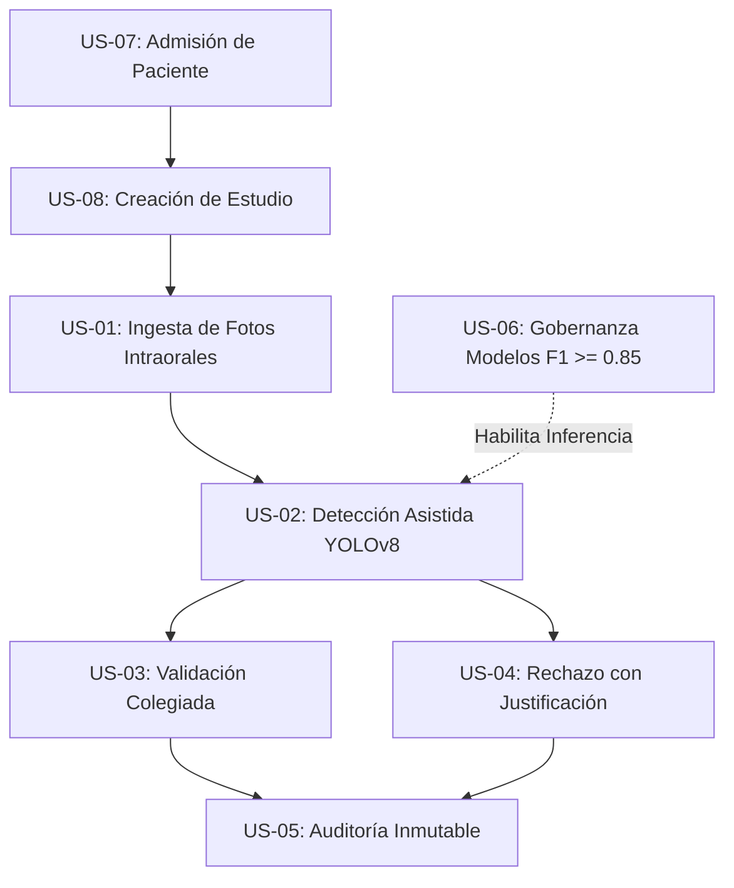

# Criterios de Aceptación (Acceptance Criteria - AC)

**Sistema:** Sistema de Apoyo al Diagnóstico Odontológico para Detección de Caries en Fotografía Intraoral (CDSS)  
**Marco de Trabajo:** Dual-Track Agile (Scrum + CRISP-DM) / BDD (Gherkin)  
**Referencia de Requerimientos:** [`docs/01-requirements/user-stories.md`](../01-requirements/user-stories.md)  
**Referencia de Pruebas:** [`docs/04-testing/test-cases.md`](../04-testing/test-cases.md)  
**Versión:** 1.0.0  
**Fecha:** 2026-11-07  

---

## 1. Invariantes del Sistema (Aplicables a todos los AC)

1. **Principio Human-in-the-Loop:** La IA nunca emite diagnósticos definitivos. Todo resultado del motor es clasificado como `SUGERIDO_IA` y requiere validación humana por odontólogo colegiado.
2. **Exclusividad Óptica:** Solo se admiten fotografías en luz visible (`.jpg`, `.png`). Formatos radiológicos (`.dcm`) o documentos (`.pdf`) son rechazados en la capa de dominio.
3. **Deduplicación Forense:** Cada imagen se indexa con su Hash SHA-256 de 64 caracteres hex. Si el hash colisiona, el sistema bloquea la carga redundante.
4. **Segregación Clínica vs. MLOps:** El flujo clínico primario del odontólogo jamás solicita seleccionar qué red neuronal o algoritmo ejecutar; opera de forma automática sobre el modelo oficial en producción (`best.pt`).
5. **Semántica de Errores HTTP:** Cero respuestas `500` para errores de negocio. Todo caso borde controlado responde `400`, `404`, `409` o `422`.

---

## 2. Catálogo de Criterios de Aceptación por Historia de Usuario

---

### US-01: Ingesta y Validación de Fotografía Intraoral (BC-02)
*Historia:* [US-01 en user-stories.md](../01-requirements/user-stories.md#us-01-ingesta-y-validación-de-fotografía-intraoral) | *Tests:* `TC-UNIT-EST-01` a `TC-UNIT-EST-08`, `TC-INT-IMG-01`, `TC-INT-IMG-02`.

#### AC-01.1: Carga exitosa de fotografía válida con SHA-256
* **Dado que** existe un paciente activo y un estudio clínico en estado `PENDIENTE`,
* **Y** el odontólogo selecciona una fotografía `.jpg`, `.jpeg` o `.png` con dimensiones $\ge 640 \times 640\text{ px}$,
* **Cuando** envía la solicitud al endpoint `POST /api/v1/estudios/{id}/imagenes`,
* **Entonces** el sistema calcula el Hash SHA-256 de la imagen,
* **Y** guarda el archivo en el almacenamiento con ruta determinista,
* **Y** persiste la entidad `ImagenIntraoral` retornando código HTTP `201 Created` con `{"id": "<uuid>"}`.

#### AC-01.2: Rechazo de formatos no ópticos (DICOM / Radiografías / PDF)
* **Dado que** el usuario intenta subir un archivo con extensión `.dcm`, `.dicom`, `.pdf` o `.gif`,
* **Cuando** se valida la extensión y cabecera en el endpoint de imágenes,
* **Entonces** el sistema rechaza la solicitud con código HTTP `422 Unprocessable Entity`,
* **Y** no se persiste ningún archivo ni registro en la base de datos,
* **Y** el mensaje de error indica que el sistema solo admite fotografías ópticas en luz visible.

#### AC-01.3: Prevención de duplicados por colisión de Hash SHA-256
* **Dado que** una fotografía con hash `H` ya fue registrada previamente en cualquier estudio del sistema,
* **Cuando** un usuario intenta subir un archivo con el mismo hash `H`,
* **Entonces** el sistema intercepta la colisión mediante el índice único de base de datos,
* **Y** responde con código HTTP `409 Conflict`,
* **Y** el mensaje notifica: *"La imagen ya existe en el repositorio clínico con el mismo hash SHA-256"*.

#### AC-01.4: Límite máximo de 10 fotografías por estudio clínico
* **Dado que** un estudio ya tiene 10 imágenes intraorales asociadas,
* **Cuando** se intenta agregar la imagen número 11,
* **Entonces** el dominio lanza `DomainException` y la API retorna HTTP `409 Conflict`,
* **Y** el estado del estudio permanece inalterado.

#### AC-01.5: Bloqueo de carga sobre estudios cerrados o en procesamiento
* **Dado que** un estudio se encuentra en estado `EN_ANALISIS` o `PROCESADO`,
* **Cuando** se intenta enviar una nueva imagen a dicho estudio,
* **Entonces** el sistema rechaza la petición con HTTP `409 Conflict` preservando la inmutabilidad de la muestra evaluada.

---

### US-02: Detección Asistida por IA y Despacho Asíncrono (BC-02 / ML)
*Historia:* [US-02 en user-stories.md](../01-requirements/user-stories.md#us-02-detección-asistida-por-ia-y-visualización-de-bounding-boxes) | *Tests:* `TC-INT-IA-01`, `test_inferencias.py`.

#### AC-02.1: Despacho asíncrono con modelo oficial homologado
* **Dado que** un estudio cuenta con al menos 1 fotografía registrada y está en estado `PENDIENTE`,
* **Cuando** el odontólogo solicita el análisis clínico mediante `POST /api/v1/estudios/{id}/analisis`,
* **Entonces** el sistema selecciona automáticamente el modelo activo con `aprobado_produccion = True` (`best.pt`),
* **Y** transita el estado del estudio a `EN_ANALISIS`,
* **Y** registra una entidad `InferenciaIA` en estado `PENDIENTE`,
* **Y** responde con código HTTP `202 Accepted` en un tiempo de respuesta $\le 150\text{ ms}$ retornando `inferencia_id` y `modelo_ml_id`.

#### AC-02.2: Generación de hallazgos con Bounding Boxes FDI y severidad
* **Dado que** el worker asíncrono toma una inferencia pendiente y procesa las imágenes con YOLOv8,
* **Cuando** el modelo detecta regiones sospechosas que superan el umbral operativo $\tau^*$,
* **Entonces** crea un `Diagnostico` en estado `SUGERIDO_IA`,
* **Y** por cada detección crea un `Hallazgo` que incluye:
  * Coordenadas normalizadas $[x_1, y_1, x_2, y_2] \in [0.0, 1.0]$.
  * Región dental FDI válida (diente permanente 11–48 o deciduo 51–85).
  * Severidad clínica clasificada (`LEVE`, `MODERADA` o `SEVERA`).
  * Nivel de confianza numérico $\in [0.0, 1.0]$ y categórico (`ALTA`, `MEDIA`, `BAJA`).
* **Y** el estudio transita al estado `PROCESADO`.

#### AC-02.3: Caso Control Sano (Cero hallazgos patológicos)
* **Dado que** las fotografías analizadas corresponden a una dentición completamente sana,
* **Cuando** el modelo finaliza la inferencia sin encontrar lesiones sobre el umbral $\tau^*$,
* **Entonces** se crea el diagnóstico en estado `SUGERIDO_IA` con lista vacía de hallazgos (`hallazgos: []`),
* **Y** el estado del estudio pasa a `PROCESADO`, notificando en la interfaz que no se observan lesiones visibles.

#### AC-02.4: Tolerancia a fallos y manejo de errores del Worker
* **Dado que** ocurre un fallo durante la ejecución de la red neuronal (archivo corrupto o memoria insuficiente),
* **Cuando** el worker captura la excepción,
* **Entonces** actualiza el estado de la inferencia a `FALLIDO` registrando el mensaje técnico en `error_mensaje`,
* **Y** el proceso worker no se detiene ni bloquea las siguientes solicitudes de la cola.

#### AC-02.5: Presupuesto de latencia de inferencia
* **Dado que** se procesa un estudio con 1 fotografía estándar ($640 \times 640\text{ px}$),
* **Cuando** se cronometra la ejecución del método `detectar()`,
* **Entonces** el tiempo total es $\le 300\text{ ms}$ con GPU o $\le 1500\text{ ms}$ con CPU local.

---

### US-03: Validación Colegiada y Aprobación de Diagnóstico (BC-03)
*Historia:* [US-03 en user-stories.md](../01-requirements/user-stories.md#us-03-validación-colegiada-y-aprobación-de-diagnóstico) | *Tests:* `TC-INT-DX-01`, `test_flujo_validacion_odontologica_completo`.

#### AC-03.1: Aprobación formal del diagnóstico asistido
* **Dado que** un diagnóstico se encuentra en estado `SUGERIDO_IA` o `EN_REVISION`,
* **Y** el odontólogo interviniente posee `autorizado_validar = True` y número de colegiatura activo,
* **Cuando** envía la orden de validación a `POST /api/v1/diagnosticos/{id}/validar` con el campo `notas` (no vacío),
* **Entonces** el diagnóstico cambia su estado a `VALIDADO`,
* **Y** se almacena la marca de tiempo UTC exacta en `fecha_validacion`,
* **Y** se genera un registro inmutable en `auditoria_diagnosticos` con el ID del profesional,
* **Y** el endpoint responde HTTP `200 OK`.

#### AC-03.2: Bloqueo de validación a personal no autorizado
* **Dado que** un usuario intenta validar un diagnóstico con un `odontologo_id` que tiene `autorizado_validar = False`,
* **Cuando** se procesa la validación,
* **Entonces** el dominio lanza excepción de seguridad y la API responde HTTP `409 Conflict`,
* **Y** el diagnóstico se mantiene en su estado original.

#### AC-03.3: Irreversibilidad del estado VALIDADO
* **Dado que** un diagnóstico ya fue marcado como `VALIDADO`,
* **Cuando** cualquier usuario intenta reabrirlo, validarlo de nuevo o rechazarlo,
* **Entonces** el sistema bloquea la operación con código HTTP `409 Conflict`,
* **Y** preserva la validez legal y clínica del diagnóstico firmado.

---

### US-04: Rechazo Clínico Justificado de Diagnóstico Sugerido (BC-03)
*Historia:* [US-04 en user-stories.md](../01-requirements/user-stories.md#us-04-rechazo-clínico-justificado-de-diagnóstico-sugerido) | *Tests:* `TC-INT-DX-02`, `test_rechazar_diagnostico_exitoso`.

#### AC-04.1: Rechazo con justificación clínica mandatoria
* **Dado que** un diagnóstico está en estado `SUGERIDO_IA` o `EN_REVISION` y el clínico detecta falsos positivos,
* **Cuando** el odontólogo autorizado envía la solicitud a `POST /api/v1/diagnosticos/{id}/rechazar` con un `motivo` explícito (ej. *"Tinciones de surcos sin cavitación"*),
* **Entonces** el diagnóstico cambia de estado a `RECHAZADO`,
* **Y** se persiste el motivo en la columna `motivo_rechazo`,
* **Y** se inserta una fila de auditoría para trazabilidad médica y realimentación de reentrenamiento,
* **Y** la API responde HTTP `200 OK`.

#### AC-04.2: Bloqueo de rechazo sin sustento clínico
* **Dado que** se envía la petición de rechazo con campo `motivo` vacío, compuesto solo de espacios o ausente,
* **Cuando** la API valida el payload de entrada,
* **Entonces** se rechaza la solicitud con código HTTP `422 Unprocessable Entity`,
* **Y** el diagnóstico permanece en revisión sin alterar su estado.

---

### US-05: Auditoría Inmutable y Trazabilidad Forense (BC-03)
*Historia:* [US-05 en user-stories.md](../01-requirements/user-stories.md#us-05-auditoría-inmutable-y-trazabilidad-forense) | *Tests:* `TC-INT-DX-01`, `TC-INT-DX-02`.

#### AC-05.1: Registro automático y cronológico de transiciones
* **Dado que** un diagnóstico transita por los estados de su ciclo de vida (`SUGERIDO_IA` $\to$ `EN_REVISION` $\to$ `VALIDADO` o `RECHAZADO`),
* **Cuando** se ejecuta cada transición,
* **Entonces** el sistema inserta automáticamente una fila en `auditoria_diagnosticos` conteniendo:
  * `diagnostico_id` (UUID).
  * `estado_anterior` y `estado_nuevo`.
  * `odontologo_id` y su número de colegiatura.
  * `motivo` o notas clínicas ingresadas.
  * `created_at` con fecha y hora UTC inalterable.

#### AC-05.2: Invariante Append-Only (Prohibición de UPDATE y DELETE)
* **Dado que** existen registros históricos en la tabla de auditoría,
* **Cuando** un cliente o proceso intenta modificar o eliminar un registro de auditoría,
* **Entonces** la base de datos o el repositorio impiden la acción, garantizando integridad forense para peritajes médico-legales.

---

### US-06: Gobernanza de Modelos ML y Regla de Corte $F1 \ge 0.85$ (BC-03 / Modelos)
*Historia:* [US-06 en user-stories.md](../01-requirements/user-stories.md#us-06-gestión-de-modelos-ml-y-aseguramiento-del-criterio-f1-ge-085) | *Tests:* `test_modelo_aprobado_produccion_f1_mayor_igual_085`.

#### AC-06.1: Aprobación de modelo que cumple umbral clínico
* **Dado que** un nuevo modelo evaluado en el conjunto de prueba independiente alcanza un $F1\text{-Score} \ge 0.85$ (ej. $F1 = 0.92$),
* **Cuando** se registra o actualiza en la entidad `ModeloML`,
* **Entonces** el sistema autoriza asignar el flag `aprobado_produccion = True`,
* **Y** queda disponible para que el worker lo utilice como detector activo de producción.

#### AC-06.2: Bloqueo categórico de modelos deficientes
* **Dado que** un modelo en pruebas obtiene un $F1\text{-Score} < 0.85$ (ej. $F1 = 0.78$),
* **Cuando** se intenta marcar como `aprobado_produccion = True`,
* **Entonces** la regla de dominio `ModeloML.puede_pasar_a_produccion()` retorna `False`,
* **Y** la capa de aplicación rechaza la operación con HTTP `409 Conflict`, impidiendo que opere en pacientes reales.

#### AC-06.3: Segregación de la vista técnica de modelos
* **Dado que** un usuario odontólogo navega por la interfaz de la clínica,
* **Cuando** revisa el menú de navegación principal,
* **Entonces** la opción "Modelos de Detección" no está visible en el menú principal,
* **Y** las métricas de entrenamiento (F1, Precisión, Recall) residen exclusivamente bajo la ruta `/admin/auditoria-modelo`, accesible solo desde el enlace discreto de gobernanza.

---

### US-07: Admisión y Directorio de Pacientes (BC-01)
*Tests:* `TC-UNIT-PAC-01` a `TC-UNIT-PAC-14`, `TC-INT-PAC-01`, `TC-INT-PAC-02`.

#### AC-07.1: Registro de paciente con DNI peruano exacto de 8 dígitos
* **Dado que** un administrativo u odontólogo ingresa los datos de un nuevo paciente,
* **Y** el DNI contiene exactamente 8 dígitos numéricos (ej. `75415745`) y no está registrado en el sistema,
* **Cuando** envía `POST /api/v1/pacientes/`,
* **Entonces** el sistema valida el Value Object `DNI`,
* **Y** normaliza el sexo canónico (`M`, `F`, `OTRO`),
* **Y** persiste al paciente en estado `ACTIVO`, respondiendo HTTP `201 Created` con el ID generado.

#### AC-07.2: Detección y bloqueo de DNI duplicado
* **Dado que** un paciente con DNI `75415745` ya existe en la base de datos,
* **Cuando** se intenta registrar otro paciente con el mismo número de documento,
* **Entonces** el sistema intercepta la colisión y responde HTTP `409 Conflict`,
* **Y** el mensaje de error detalla: *"Ya existe un paciente registrado con el DNI '75415745'"*.

#### AC-07.3: Validación de formato de teléfono celular y correo
* **Dado que** se ingresa un número de teléfono con formato inválido (menos de 9 dígitos, letras o prefijos incompatibles),
* **Cuando** se procesa la validación del Value Object `Telefono`,
* **Entonces** el sistema lanza `ValueError` y la API retorna HTTP `422 Unprocessable Entity`,
* **Y** solo se aceptan teléfonos celulares peruanos (`9XXXXXXXX`) o internacionales con prefijo (`+\d{7,15}`).

---

### US-08: Repositorio e Historial de Estudios Fotográficos (BC-02)
*Tests:* `TC-INT-EST-01`, `TC-INT-EST-02`, pruebas frontend `EstudiosList.jsx`.

#### AC-08.1: Creación de estudio imagenológico vinculado
* **Dado que** se especifica un `paciente_id` válido y activo en el sistema,
* **Y** se define un tipo de examen fotográfico estandarizado (`FOTOGRAFIA_INTRAORAL`, `SERIE_COMPLETA`, etc.),
* **Cuando** se ejecuta `POST /api/v1/estudios/`,
* **Entonces** el sistema inicializa el estudio en estado `PENDIENTE`,
* **Y** responde HTTP `201 Created` con el ID del estudio creado.

#### AC-08.2: Listado general y filtrado clínico de estudios
* **Dado que** existen estudios en diversos estados (`PENDIENTE`, `EN_ANALISIS`, `PROCESADO`),
* **Cuando** el odontólogo consulta `GET /api/v1/estudios/?estado=PROCESADO`,
* **Entonces** el sistema responde HTTP `200 OK` con la lista de estudios filtrados,
* **Y** cada elemento expone: `id`, `paciente_nombre`, `paciente_dni`, `tipo_examen`, `estado_procesamiento`, `total_imagenes` y `diagnostico_id`.

#### AC-08.3: Visualización de tarjetas clínicas en Frontend
* **Dado que** el odontólogo accede a la vista `/estudios`,
* **Cuando** se renderizan las tarjetas de estudios,
* **Entonces** cada tarjeta muestra el badge con texto completo sin desbordamiento (`COMPLETADO`, `EN ANÁLISIS`, `PENDIENTE`),
* **Y** si el estudio cuenta con diagnóstico validado o sugerido, muestra el botón de acción con ícono documental `FileText` y texto *"Informe"*, sin íconos de estrellas ni elementos de distracción visual.

---

## 3. Matriz de Trazabilidad: Historia vs. AC vs. Códigos HTTP vs. Tests

| Historia | Criterio de Aceptación (AC) | Código HTTP Esperado | ID de Prueba en [`test-cases.md`](../04-testing/test-cases.md) |
| :--- | :--- | :--- | :--- |
| **US-01** | AC-01.1: Carga válida con Hash SHA-256 | `201 Created` | `TC-INT-IMG-01`, `TC-UNIT-EST-03` |
| **US-01** | AC-01.2: Rechazo formato no óptico (DICOM/PDF) | `422 Unprocessable` | `TC-UNIT-EST-02` |
| **US-01** | AC-01.3: Prevención colisión Hash SHA-256 | `409 Conflict` | `TC-INT-IMG-02`, `TC-UNIT-EST-04` |
| **US-01** | AC-01.4: Límite de 10 imágenes por estudio | `409 Conflict` | `TC-UNIT-EST-08` |
| **US-01** | AC-01.5: Bloqueo sobre estudio cerrado | `409 Conflict` | `test_no_se_pueden_agregar_imagenes_a_estudio_en_analisis` |
| **US-02** | AC-02.1: Despacho asíncrono modelo oficial | `202 Accepted` | `TC-INT-IA-01` |
| **US-02** | AC-02.2: Generación hallazgos FDI y severidad | Asíncrono / Evento | `test_crear_diagnostico_desde_ia_exitoso` |
| **US-02** | AC-02.3: Caso Control Sano (cero hallazgos) | Asíncrono / Evento | `test_diagnosticos.py` |
| **US-02** | AC-02.4: Manejo de fallo del Worker (`FALLIDO`) | Asíncrono / Evento | `test_fallar_inferencia_guarda_mensaje_y_emite_evento` |
| **US-02** | AC-02.5: SLA de latencia ($\le 1500\text{ ms}$) | Telemetría | `test_tiempo_inferencia_valido` |
| **US-03** | AC-03.1: Aprobación formal colegiada | `200 OK` | `TC-INT-DX-01`, `test_flujo_validacion_odontologica_completo` |
| **US-03** | AC-03.2: Bloqueo a odontólogo no autorizado | `409 Conflict` | `test_odontologo_no_autorizado_no_puede_validar` |
| **US-03** | AC-03.3: Irreversibilidad del estado VALIDADO | `409 Conflict` | `test_diagnostico_validado_es_irreversible` |
| **US-04** | AC-04.1: Rechazo con justificación obligatoria | `200 OK` | `TC-INT-DX-02`, `test_rechazar_diagnostico_exitoso` |
| **US-04** | AC-04.2: Bloqueo de rechazo sin motivo | `422 Unprocessable` | `test_rechazar_diagnostico_motivo_vacio_lanza_excepcion` |
| **US-05** | AC-05.1: Registro cronológico en auditoría | `200 OK` | `TC-INT-DX-01`, `TC-INT-DX-02` |
| **US-05** | AC-05.2: Invariante Append-Only | DB Constraint | `test_auditoria_inmutable` |
| **US-06** | AC-06.1: Aprobación con $F1 \ge 0.85$ | `200 OK` | `test_modelo_aprobado_produccion_f1_mayor_igual_085` |
| **US-06** | AC-06.2: Bloqueo de modelo con $F1 < 0.85$ | `409 Conflict` | `test_modelo_no_aprobado_produccion_f1_menor_085` |
| **US-06** | AC-06.3: Segregación técnica en `/admin` | Frontend Routing | `DashboardLayout.jsx`, `routes.jsx` |
| **US-07** | AC-07.1: Registro con DNI 8 dígitos | `201 Created` | `TC-INT-PAC-01`, `TC-UNIT-PAC-01` |
| **US-07** | AC-07.2: Detección DNI duplicado | `409 Conflict` | `TC-INT-PAC-02` |
| **US-07** | AC-07.3: Validación celular peruano e email | `422 Unprocessable` | `TC-UNIT-PAC-05`, `TC-UNIT-PAC-09` |
| **US-08** | AC-08.1: Creación de estudio imagenológico | `201 Created` | `TC-INT-EST-01`, `test_crear_estudio_exitoso` |
| **US-08** | AC-08.2: Listado y filtrado de estudios | `200 OK` | `listar_estudios`, `useEstudiosList` |
| **US-08** | AC-08.3: Visualización de tarjetas clínicas | Frontend UI | `EstudiosList.jsx` |
