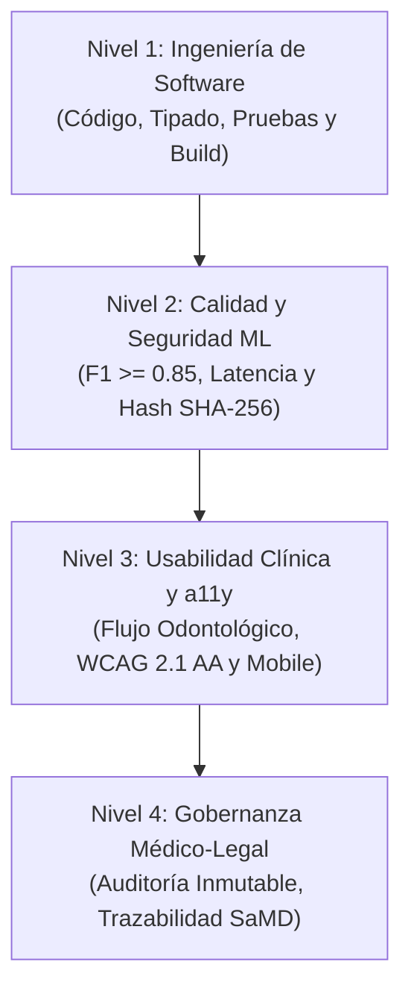

# Definition of Done (DoD) — Criterios de Finalización

**Sistema:** Sistema de Apoyo al Diagnóstico Odontológico (CDSS)  
**Versión:** 1.0.0  
**Objetivo:** Establecer las condiciones verificables que debe cumplir un incremento de software o modelo de IA para ser considerado formalmente terminado y apto para su integración en el entorno clínico.

---

## 1. Pirámide de Niveles de Calidad (DoD)

Para certificar un entregable en este sistema médico, debe superarse la lista de verificación en **cuatro niveles progresivos**:

---

## 2. Nivel 1: Calidad de Software & Backend (Engineering DoD)

Aplica a todo código fuente del backend y capas de aplicación/infraestructura:

- [ ] **Tests Automatizados en Verde:**
  - `pytest tests/unit` ejecuta el 100% de pruebas pasando sin excepciones (`code 0`).
  - Pruebas de integración de repositorios y endpoints API ejecutadas sin errores `500`.
- [ ] **Respeto a la Arquitectura Hexagonal:**
  - El Dominio (`app/domain/`) no tiene dependencias hacia SQLAlchemy, FastAPI, Pydantic ni Ultralytics.
  - La persistencia se realiza exclusivamente a través de interfaces de repositorio (`save`, `get_by_id`).
- [ ] **Contratos de API Estrictos:**
  - Rutas REST retornan los códigos HTTP semánticos correctos (`200 OK`, `201 Created`, `202 Accepted`, `404 Not Found`, `409 Conflict`, `422 Unprocessable Entity`).
  - Manejo de excepciones de dominio mapeadas a códigos de error comprensibles sin fugas de trazas internas (*stack traces*).
- [ ] **Idempotencia y Migraciones:**
  - Modelos relacionales reflejados en migraciones Alembic versionadas.
  - Scripts de datos o seeders ejecutables múltiples veces sin duplicar registros (`seed.py --reset`).

---

## 3. Nivel 2: Calidad de Machine Learning & Inferencia (MLOps DoD)

Aplica a componentes de IA, adaptadores y workers de predicción:

- [ ] **Métricas Clínicas de Homologación:**
  - El modelo alcanza un $F1\text{-Score} \ge 0.85$ en el conjunto de prueba independiente.
  - Registrado en la base de datos (`modelos_ml`) con flag `aprobado_produccion = True`.
- [ ] **Trazabilidad del Artefacto de Pesos:**
  - Archivo de pesos (`best.pt`) almacenado con su Hash SHA-256 verificado.
  - Metadatos registrados: versión semántica, arquitectura (`YOLOv8`), precisión y recall.
- [ ] **Presupuesto de Latencia Cumplido:**
  - Inferencia asíncrona completada en $\le 300\text{ ms}$ (aceleración GPU) o $\le 1500\text{ ms}$ (CPU local).
  - El pipeline no bloquea el hilo principal del servidor API (ejecución mediante worker de fondo).

---

## 4. Nivel 3: Experiencia de Usuario & Accesibilidad (Frontend DoD)

Aplica a la interfaz de usuario en React:

- [ ] **Build de Producción Limpio:**
  - `npm run build` compila exitosamente (`dist/`) con cero errores y cero advertencias críticas.
- [ ] **Gobernanza del Mental Model Clínico:**
  - La navegación principal visible para el odontólogo contiene exclusivamente:
    1. `Cola de Revisión` (`/revision`)
    2. `Pacientes` (`/pacientes`)
    3. `Estudios Fotográficos` (`/estudios`)
  - La vista de modelos y métricas técnicas queda estrictamente segregada en la ruta secundaria `/admin/auditoria-modelo`.
  - El botón de análisis ejecuta directamente el detector oficial (`best.pt`) sin requerir selección algorítmica por el clínico.
- [ ] **Responsividad Móvil (Sillón Dental):**
  - Barra inferior móvil con 3 accesos ergonómicos en anchos de $360\text{ px} - 390\text{ px}$.
  - Tarjetas y badges de estado sin desbordamiento de texto ni truncamiento por elipsis en pantallas estrechas.
- [ ] **Accesibilidad (WCAG 2.1 AA):**
  - Relación de contraste de texto e indicadores $\ge 4.5:1$.
  - Navegación completa mediante teclado (foco visible, activación con `Enter`/`Space`).

---

## 5. Nivel 4: Gobernanza Médico-Legal & Auditoría (SaMD DoD)

Aplica al flujo de validación y persistencia de actos odontológicos:

- [ ] **No Repudio y Firma Colegiada:**
  - La validación clínica registra obligatoriamente: `odontologo_id`, número de colegiatura activa y fecha/hora UTC exacta.
- [ ] **Rechazo Clínico con Justificación Mandatoria:**
  - No es posible rechazar un diagnóstico asistido sin consignar el campo `motivo_rechazo`.
- [ ] **Auditoría Forense Inmutable:**
  - Cada transición de estado (`SUGERIDO_IA` $\to$ `VALIDADO` o `RECHAZADO`) persiste una fila inalterable en `auditoria_diagnosticos`.
  - La imagen intraoral se almacena con su Hash SHA-256 para prevenir manipulaciones posteriores.

