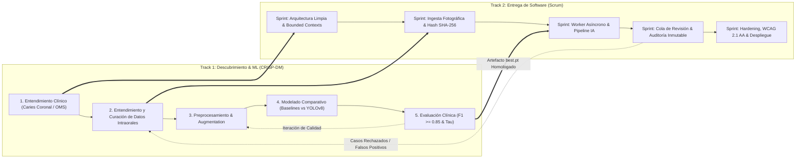

# Marco Metodológico: Scrum + CRISP-DM (CDSS Odontológico)

**Sistema:** Sistema de Apoyo al Diagnóstico Odontológico para Detección de Caries en Fotografía Intraoral (CDSS)  
**Clasificación:** Software Médico de Apoyo / SaMD (*Software as a Medical Device*)  
**Estándares de Referencia:** IEC 62304 (Ciclo de Vida de Software Médico) / ISO 13485 / GMLP (*Good Machine Learning Practice*)  
**Versión:** 1.0.0  
**Fecha:** 2026-11-07  

---

## 1. Justificación del Enfoque Híbrido

El desarrollo de un sistema de diagnóstico asistido por IA presenta una dualidad técnica fundamental:

1. **Ingeniería de Software (Determinista y Centrada en el Usuario):** Requiere entregas continuas, control de calidad estricto, interfaces accesibles y contratos de API estables. Se gestiona eficazmente con **Scrum**.
2. **Ciencia de Datos / Machine Learning (Probabilístico y Exploratorio):** Requiere experimentación de arquitecturas, calibración de hiperparámetros, curación de datasets y validación estadística ($F1 \ge 0.85$). Se gestiona con **CRISP-DM** (o *CRISP-ML(Q)*).

> [!IMPORTANT]
> **Regla Anti-Alucinación:** No se fuerza el ciclo de experimentación de Machine Learning en sprints rígidos de 2 semanas sin un entregable previo validado. El modelo entrenado se trata en Scrum como un **artefacto empaquetado y homologado** que implementa un puerto de dominio (`IDetectorPatologias`).

---

## 2. Arquitectura de Procesos: Dual-Track Agile

El equipo opera bajo el modelo **Dual-Track** en dos vías sincronizadas:

1. **Track de Datos / CRISP-DM:** Trabaja 1 o 2 iteraciones adelante en la preparación de datos y evaluación de modelos.
2. **Track de Software / Scrum:** Consume los modelos validados (`best.pt`) y construye la plataforma operativa (FastAPI + React + PostgreSQL + Celery/Worker).
3. **Bucle de Realimentación:** Los diagnósticos marcados como `RECHAZADO` por los odontólogos en producción alimentan la fase 2 de CRISP-DM para futuros ciclos de reentrenamiento.

---

## 3. Milestones del Proyecto (Hitos de Integración)

Los hitos sincronizan las fases de CRISP-DM con las versiones funcionales de Scrum:

| Milestone | Fase CRISP-DM | Entregables Scrum / Software | Criterio de Éxito / Puerta de Calidad |
| :--- | :--- | :--- | :--- |
| **M1: Fundamentos Clínicos & Arquitectura** | *Business Understanding* | Arquitectura Hexagonal, Bounded Contexts DDD, Modelos relacionales base. | Protocolo de Caries Coronal (OMS CPO-D/ceo-d) formalizado. Criterio $F1 \ge 0.85$ codificado en el dominio. |
| **M2: Ingesta & Deduplicación de Imágenes** | *Data Understanding & Prep* | Módulo de Pacientes (BC-01) y Estudios (BC-02). Deduplicación por Hash SHA-256. | Cero formatos radiológicos aceptados (rechazo de `.dcm`). Prevención de duplicados verificada. |
| **M3: Motor de Inferencia & Auditoría ML** | *Modeling & Evaluation* | Worker asíncrono, adaptador YOLOv8, panel técnico `/admin/auditoria-modelo`. | YOLOv8n entrenado y comparado contra baselines ($F1 \ge 0.85$, $p95 \le 1500\text{ ms}$). |
| **M4: Flujo Clínico CDSS & No Repudio** | *Deployment (Fase 1)* | Cola de revisión (`/revision`), aprobación colegiada, rechazo con motivo y tabla de auditoría. | Odontólogo valida o rechaza con firma colegiada. Trazabilidad inalterable de auditoría. |
| **M5: Verificación, Accesibilidad & Deploy** | *Monitoring & Hardening* | Suite de pruebas unitarias/integración (100% pass), WCAG 2.1 AA, Docker Compose. | Cero errores de compilación, responsividad móvil para sillón dental validada. |

---

## 4. Roles y Responsabilidades Claras

Para evitar solapamientos y alucinaciones en agentes de IA y desarrolladores:

* **Odontólogo / Lead Clínico:** Define protocolos diagnósticos (FDI, OMS CPO-D), revisa casos límite y valida la taxonomía de hallazgos.
* **ML Engineer / Data Scientist:** Gestiona el ciclo CRISP-DM, entrena y calibra modelos, y entrega artefactos con metadatos completos (pesos, $F1$, precisión, recall).
* **Backend Engineer:** Implementa la lógica de dominio puro (DDD), routers FastAPI, seguridad, orquestación de tareas y persistencia transaccional.
* **Frontend / UX Designer:** Desarrolla la estación clínica en React garantizando accesibilidad (WCAG 2.1 AA), usabilidad táctil móvil y eliminación de jerga técnica innecesaria.
* **QA / Test Engineer:** Verifica la pirámide de pruebas (unitarias, integración, contrato y E2E), verificando que se cumplan DoR y DoD.
* **Agentes de IA (LLMs / Asistentes):** Generan código respetando estrictamente los contratos de API, sin modificar interfaces de dominio consolidadas ni introducir dependencias no aprobadas.

