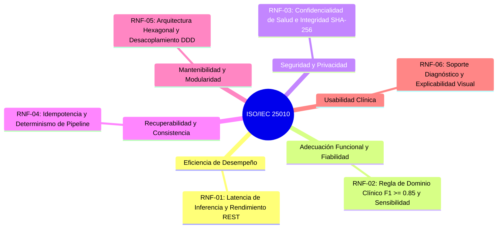

# Especificación de Requerimientos No Funcionales (RNF)

**Estándar:** ISO/IEC 25010:2011 — Systems and software engineering — Systems and software Quality Requirements and Evaluation (SQuaRE)  
**Sistema:** Sistema de Apoyo al Diagnóstico Odontológico para Detección de Caries en Fotografía Intraoral (CDSS)  
**Versión:** 1.0.0  
**Fecha:** 2026-09-29  

---

## 1. Clasificación según ISO/IEC 25010

---

## 2. Detalle de Requerimientos No Funcionales

### RNF-01: Eficiencia de Desempeño (Performance Efficiency)
* **Subcaracterísticas:** Comportamiento temporal, utilización de recursos y capacidad.
* **Métricas y Criterios de Aceptación:**
  1. **Latencia de Inferencia del Modelo:**
     - En inferencia sobre GPU dedicada (CUDA / Tensor Cores): el tiempo de procesamiento de una fotografía intraoral no debe exceder los **$300\text{ ms}$**.
     - En inferencia sobre CPU estándar en PC local: el tiempo de procesamiento no debe superar los **$1,500\text{ ms}$** por imagen a resolución nativa de inferencia ($640 \times 640$).
  2. **Tiempo de Respuesta de la API REST:**
     - Los endpoints de consulta (queries CQRS) deben responder en un percentil $p95$ inferior a **$200\text{ ms}$** bajo una carga concurrente normal de 20 peticiones simultáneas.
  3. **Desacoplamiento Asíncrono:**
     - El endpoint de solicitud de análisis (`POST /api/v1/diagnosticos/analizar`) debe liberar la conexión HTTP en menos de **$150\text{ ms}$** retornando un estado `202 Accepted`, delegando el procesamiento al worker en segundo plano sin bloquear el hilo principal de la aplicación.

### RNF-02: Fiabilidad y Exactitud Clínica (Reliability & Functional Suitability)
* **Subcaracterísticas:** Madurez, tolerancia a fallos y corrección de resultados.
* **Métricas y Criterios de Aceptación:**
  1. **Regla de Dominio Clínico $F1\text{-Score}$:**
     - Ningún modelo de Machine Learning podrá ser promovido a producción en `modelos_ml` con `aprobado_produccion = True` si su métrica global en el conjunto de test independiente no satisface la restricción:
       $$F1\text{-Score} \ge 0.85$$
  2. **Sensibilidad Diagnóstica (Recall):**
     - Para minimizar el subdiagnóstico crítico en salud pública (omisión de caries activa), el modelo debe mantener un **Recall $\ge 0.90$** en caries permanente y un **Recall $\ge 0.75$** en caries decidua.
  3. **Disponibilidad del Servicio:**
     - El backend debe garantizar una tasa de disponibilidad del **99.5%** durante el horario de atención clínica, soportado por reinicios automáticos de procesos en contenedores Docker.

### RNF-03: Seguridad y Privacidad en Salud (Security & Privacy)
* **Subcaracterísticas:** Confidencialidad, integridad, no repudio y autenticación.
* **Métricas y Criterios de Aceptación:**
  1. **Protección de Datos Médicos Sensibles:**
     - El sistema debe proteger la identidad del paciente conforme a estándares internacionales de e-Health (ISO 27799 y directrices HIPAA). Las imágenes almacenadas en el sistema de archivos no deben contener metadatos EXIF con geolocalización o datos personales incrustados.
  2. **Integridad Criptográfica de la Evidencia:**
     - Toda imagen ingerida debe ser sellada digitalmente con su resumen criptográfico **SHA-256**, impidiendo alteraciones posteriores del archivo y garantizando la cadena de custodia de la prueba clínica.
  3. **Control de Acceso Basado en Roles (RBAC):**
     - La validación final de un diagnóstico está restringida a usuarios autenticados con rol de Odontólogo que cuenten con cédula/colegiatura profesional activa.

### RNF-04: Idempotencia y Determinismo (Recoverability & Reliability)
* **Subcaracterísticas:** Consistencia y estabilidad ante reintentos.
* **Métricas y Criterios de Aceptación:**
  1. **Idempotencia en Procesamiento:**
     - El reenvío accidental de una misma imagen intraoral no debe generar duplicidad de registros ni ejecuciones redundantes de GPU; la validación de hash SHA-256 intercepta la solicitud de forma determinista.
  2. **Determinismo Algorítmico:**
     - En modo de evaluación e inferencia, la red YOLOv8 se ejecuta en modo de solo lectura (`with torch.no_grad()`, `model.eval()`). Ante la misma imagen de entrada con el mismo umbral de confianza $\tau^*$, el sistema debe producir exactamente los mismos bounding boxes, coordenadas y puntuaciones de probabilidad.

### RNF-05: Mantenibilidad y Modularidad (Maintainability & Modularity)
* **Subcaracterísticas:** Modularidad, reusabilidad, modificabilidad y comprobabilidad.
* **Métricas y Criterios de Aceptación:**
  1. **Aislamiento de Dominio (Clean / Hexagonal Architecture):**
     - La capa de Dominio (`app/domain/`) no debe tener ninguna dependencia externa de frameworks web (`fastapi`, `starlette`), ORMs (`sqlalchemy`) o librerías de Machine Learning (`ultralytics`, `torch`).
  2. **Patrón Adapter para Visión Artificial:**
     - El componente de inferencia debe encapsularse tras la interfaz `IDetectorPatologias`. El reemplazo de YOLOv8 por un modelo futuro (ej. RT-DETR, Mask R-CNN o ensemble) debe requerir únicamente la creación de un nuevo adaptador de infraestructura sin modificar la lógica de negocio ni los controladores REST.
  3. **Cobertura y Comprobabilidad:**
     - Las reglas de negocio de los Value Objects y Entities de dominio deben ser verificables mediante pruebas unitarias puras sin necesidad de levantar bases de datos ni GPUs.

### RNF-06: Usabilidad y Soporte Clínico a la Decisión (Usability)
* **Subcaracterísticas:** Reconocimiento de idoneidad, operabilidad y protección contra errores de usuario.
* **Métricas y Criterios de Aceptación:**
  1. **Normalización Espacial Estandarizada:**
     - Todas las coordenadas de las detecciones se exponen normalizadas en el rango $[0.0, 1.0]$ ($[x_1, y_1, x_2, y_2]$), permitiendo que cualquier cliente frontend (web o móvil) renderice las superposiciones diagnósticas de forma responsiva sin deformaciones.
  2. **Gradación de Severidad y Certeza:**
     - Para mitigar el efecto de "caja negra" en la adopción médica, el sistema no se limita a un resultado binario: descompone el hallazgo en niveles de severidad (`LEVE`, `MODERADA`, `SEVERA`) y categorías de certeza (`BAJA`, `MEDIA`, `ALTA`).
  3. **Principio de Soporte, No Reemplazo:**
     - El software prohíbe técnicamente que una sugerencia de IA se registre como diagnóstico definitivo sin la intervención explícita y firma digital del odontólogo humano responsable.
