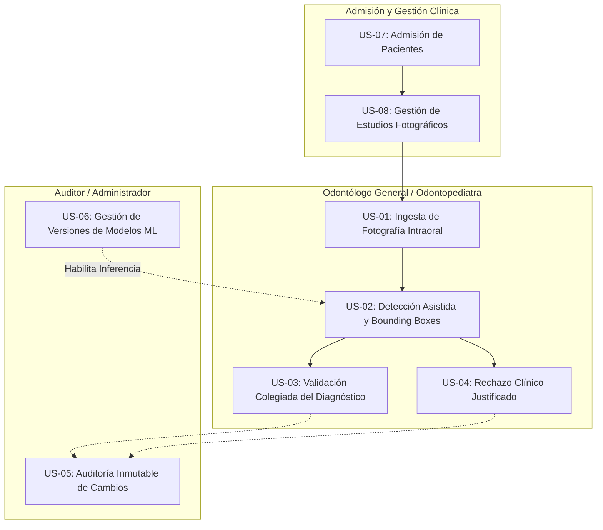

# Historias de Usuario (User Stories)

**Sistema:** Sistema de Apoyo al Diagnóstico Odontológico para Detección de Caries en Fotografía Intraoral (CDSS)  
**Metodología:** Dual-Track Agile (Scrum + CRISP-DM) / BDD (ver [`00-methodology`](../00-methodology/methodology.md))  
**Gobernanza:** [`DoR`](../00-methodology/dor.md) | [`DoD`](../00-methodology/dod.md) | [`Criterios de Aceptación`](../00-methodology/acceptance-criteria.md)  
**Versión:** 1.0.0  
**Fecha:** 2026-09-29  

---

## 1. Roles del Sistema

* **Odontólogo General / Odontopediatra:** Profesional de la salud bucal colegiado responsable del examen físico, captura de fotografías intraorales, revisión de hallazgos sugeridos por la IA y emisión del diagnóstico clínico definitivo.
* **Administrador del Sistema / Auditor Clínico:** Responsable de la gestión técnica, auditoría de cambios en historias clínicas, trazabilidad médico-legal y supervisión de las versiones de modelos de Machine Learning en producción.

---

## 2. Catálogo de Historias de Usuario

---

### US-01: Ingesta y Validación de Fotografía Intraoral
**Como** Odontólogo,  
**Quiero** subir una fotografía intraoral directa asociada a un estudio del paciente,  
**Para** registrar la evidencia visual en la historia clínica y solicitar su análisis automatizado.

#### Criterios de Aceptación (Gherkin):
* **Escenario 1: Carga exitosa de fotografía válida**
  - **Dado que** el odontólogo ha seleccionado un paciente activo y un estudio clínico,
  - **Y** selecciona un archivo con formato `.jpg` o `.png` con dimensiones mínimas de $640 \times 640$,
  - **Cuando** presiona el botón de subir imagen,
  - **Entonces** el sistema calcula el hash SHA-256 de la imagen,
  - **Y** almacena el archivo en el directorio correspondiente,
  - **Y** crea el registro en la base de datos con estado `PENDIENTE`, retornando código HTTP `201 Created`.

* **Escenario 2: Rechazo de formato no óptico (Intento de subir DICOM/radiografía)**
  - **Dado que** el odontólogo intenta subir un archivo con extensión `.dcm` o formato radiológico,
  - **Cuando** se envía la petición al backend,
  - **Entonces** el sistema rechaza la carga con código HTTP `422 Unprocessable Entity`,
  - **Y** notifica que el sistema está calibrado exclusivamente para fotografías en luz visible.

* **Escenario 3: Prevención de duplicados mediante Hash SHA-256**
  - **Dado que** una fotografía con el mismo contenido en bytes ya fue registrada previamente en el sistema,
  - **Cuando** el usuario intenta subir el mismo archivo nuevamente,
  - **Entonces** el sistema detecta la colisión de hash SHA-256,
  - **Y** retorna un código HTTP `409 Conflict`, impidiendo el gasto redundante de almacenamiento.

---

### US-02: Detección Asistida por IA y Visualización de Bounding Boxes
**Como** Odontólogo,  
**Quiero** solicitar el análisis automático de una fotografía intraoral mediante el modelo YOLOv8,  
**Para** identificar rápidamente posibles caries coronales en piezas permanentes y deciduas con su nivel de severidad.

#### Criterios de Aceptación (Gherkin):
* **Escenario 1: Generación exitosa de hallazgos sugeridos**
  - **Dado que** un estudio con fotografías válidas está registrado en estado `PENDIENTE`,
  - **Cuando** el odontólogo solicita el análisis automático,
  - **Entonces** el sistema despacha la tarea al worker de fondo retornando `202 Accepted`,
  - **Y** el modelo YOLOv8 identifica las regiones sospechosas con confianza $\ge \tau^*$,
  - **Y** se genera un diagnóstico en estado `SUGERIDO_IA`,
  - **Y** cada hallazgo incluye coordenadas normalizadas $[x_1, y_1, x_2, y_2]$, tipo (`caries_permanente` o `caries_decidua`) y severidad (`LEVE`, `MODERADA` o `SEVERA`).

* **Escenario 2: Fotografía sin patologías detectadas (Control Sano)**
  - **Dado que** la fotografía corresponde a una dentición completamente sana,
  - **Cuando** el modelo finaliza la inferencia,
  - **Entonces** se genera el diagnóstico en estado `SUGERIDO_IA` con confianza global asociada pero lista de hallazgos vacía (`hallazgos = []`),
  - **Y** el sistema notifica que no se detectaron lesiones visibles que superen el umbral clínico.

---

### US-03: Validación Colegiada y Aprobación de Diagnóstico
**Como** Odontólogo,  
**Quiero** revisar las sugerencias de la IA, modificar o ratificar los hallazgos y firmar el diagnóstico con mi colegiatura,  
**Para** conferirle validez clínica legal e incorporarlo al plan de tratamiento del paciente.

#### Criterios de Aceptación (Gherkin):
* **Escenario 1: Aprobación del diagnóstico asistido**
  - **Dado que** existe un diagnóstico en estado `SUGERIDO_IA` o `EN_REVISION`,
  - **Y** el odontólogo autenticado posee número de colegiatura vigente y `autorizado_validar = True`,
  - **Cuando** el odontólogo emite la orden de validación junto con sus notas clínicas,
  - **Entonces** el estado del diagnóstico cambia a `VALIDADO`,
  - **Y** se registra la fecha/hora UTC exacta (`fecha_validacion`) y el `odontologo_id`,
  - **Y** se genera un evento inmutable en la tabla de auditoría clínica.

---

### US-04: Rechazo Clínico Justificado de Diagnóstico Sugerido
**Como** Odontólogo,  
**Quiero** rechazar formalmente un diagnóstico sugerido por la IA especificando el motivo,  
**Para** evitar diagnósticos erróneos provocados por falsos positivos (ej. tinciones de fisuras o reflejos de saliva).

#### Criterios de Aceptación (Gherkin):
* **Escenario 1: Rechazo con justificación obligatoria**
  - **Dado que** el odontólogo detecta que los hallazgos sugeridos son artefactos o discrepancias clínicas,
  - **Cuando** selecciona rechazar el diagnóstico e ingresa el motivo: *"Surco teñido anatómico sin desmineralización de esmalte"*,
  - **Entonces** el sistema actualiza el estado a `RECHAZADO`,
  - **Y** persiste el motivo en `motivo_rechazo`,
  - **Y** se registra la entrada en `auditoria_diagnosticos` para análisis de mejora continua de los modelos.

* **Escenario 2: Intento de rechazo sin motivo**
  - **Dado que** el odontólogo intenta marcar como rechazado el diagnóstico sin enviar el campo `motivo_rechazo`,
  - **Cuando** se procesa la solicitud,
  - **Entonces** el sistema bloquea la operación con código HTTP `422 Unprocessable Entity` exigiendo el sustento clínico.

---

### US-05: Auditoría Inmutable y Trazabilidad Forense
**Como** Auditor Clínico / Director Médico,  
**Quiero** consultar la cronología completa de modificaciones y firmas de un diagnóstico,  
**Para** verificar el cumplimiento ético, la responsabilidad profesional y la trazabilidad médico-legal.

#### Criterios de Aceptación (Gherkin):
* **Escenario 1: Consulta del historial de auditoría**
  - **Dado que** un diagnóstico ha transitado por los estados `SUGERIDO_IA` $\to$ `EN_REVISION` $\to$ `VALIDADO`,
  - **Cuando** el auditor consulta el historial mediante el endpoint de auditoría,
  - **Entonces** el sistema retorna la secuencia cronológica ordenada de eventos,
  - **Y** cada registro expone el estado anterior, estado nuevo, odontólogo interviniente y marca de tiempo inalterable.

---

### US-06: Gestión de Modelos ML y Aseguramiento del Criterio $F1 \ge 0.85$
**Como** Administrador del Sistema / Ingeniero de Machine Learning,  
**Quiero** registrar nuevos modelos entrenados y verificar que cumplan la cota de desempeño antes de activarlos,  
**Para** evitar que modelos subóptimos o no homologados operen en el entorno de producción.

#### Criterios de Aceptación (Gherkin):
* **Escenario 1: Activación de modelo que cumple estándar**
  - **Dado que** un modelo evaluado en test split obtiene un $F1\text{-Score} = 0.865$,
  - **Cuando** se solicita su registro como modelo activo de producción,
  - **Entonces** el sistema valida que $F1 \ge 0.85$,
  - **Y** habilita el flag `aprobado_produccion = True`, permitiendo que el adaptador YOLO cargue sus pesos.

* **Escenario 2: Bloqueo de modelo deficiente**
  - **Dado que** un modelo en pruebas preliminares obtiene un $F1\text{-Score} = 0.79$,
  - **Cuando** se intenta marcar como `aprobado_produccion = True`,
  - **Entonces** el sistema rechaza la operación informando que no supera el umbral de seguridad clínica establecido.

---

### US-07: Admisión y Directorio de Pacientes
**Como** Odontólogo / Personal de Admisión Clínica,  
**Quiero** registrar y consultar historias clínicas de pacientes con sus datos de contacto y DNI validado,  
**Para** asociar de forma unívoca los estudios fotográficos y diagnósticos a la persona correcta.

#### Criterios de Aceptación (Gherkin):
* **Escenario 1: Registro exitoso con DNI peruano de 8 dígitos**
  - **Dado que** se ingresan los datos de un paciente con DNI de 8 dígitos numéricos no registrado previamente,
  - **Cuando** se envía la solicitud de registro al endpoint `POST /api/v1/pacientes/`,
  - **Entonces** el sistema valida los campos, normaliza el sexo canónico (`M`, `F`, `OTRO`),
  - **Y** persiste el registro en estado `ACTIVO` respondiendo HTTP `201 Created`.

* **Escenario 2: Detección y prevención de DNI duplicado**
  - **Dado que** un paciente con el DNI ingresado ya existe en la base de datos,
  - **Cuando** se intenta enviar nuevamente el formulario de admisión,
  - **Entonces** el sistema rechaza la operación con código HTTP `409 Conflict`,
  - **Y** no genera registros duplicados en el repositorio clínico.

---

### US-08: Repositorio e Historial de Estudios Fotográficos
**Como** Odontólogo,  
**Quiero** consultar y filtrar el repositorio de estudios fotográficos intraorales de la clínica,  
**Para** supervisar adquisiciones pendientes, estudios en análisis y acceder directamente a los informes CDSS.

#### Criterios de Aceptación (Gherkin):
* **Escenario 1: Creación de estudio imagenológico vinculado**
  - **Dado que** existe un paciente activo seleccionado en consulta,
  - **Cuando** el odontólogo crea un nuevo estudio especificando el tipo de examen intraoral,
  - **Entonces** el sistema inicializa el estudio en estado `PENDIENTE` respondiendo HTTP `201 Created`.

* **Escenario 2: Listado y filtrado clínico de estudios**
  - **Dado que** existen múltiples estudios fotográficos en la base de datos,
  - **Cuando** el clínico consulta la vista general o el endpoint `GET /api/v1/estudios/`,
  - **Entonces** el sistema retorna la colección de estudios con badges de estado sin truncamiento (`COMPLETADO`, `EN ANÁLISIS`, `PENDIENTE`),
  - **Y** habilita accesos directos al visor de fotografías y al informe clínico CDSS.
