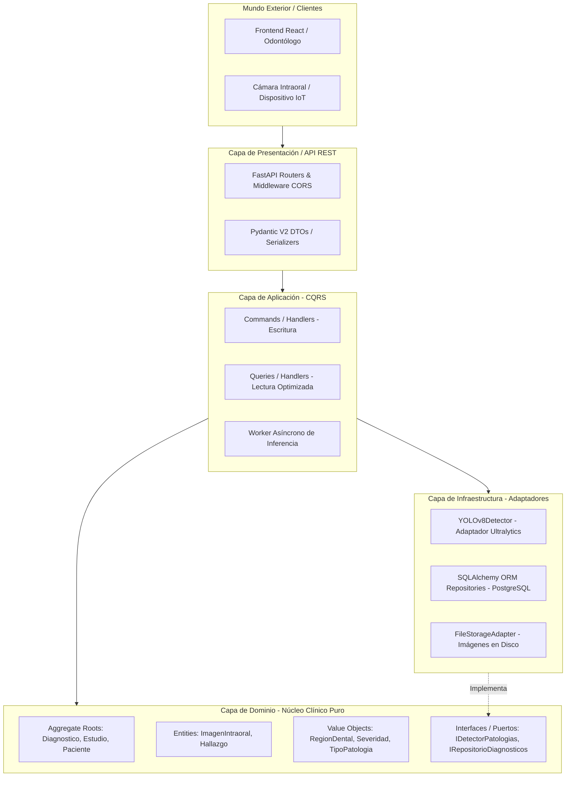
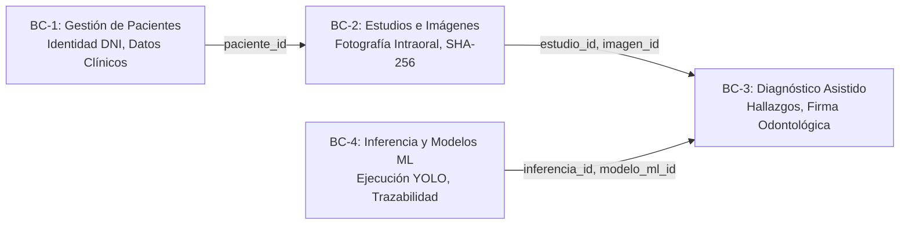
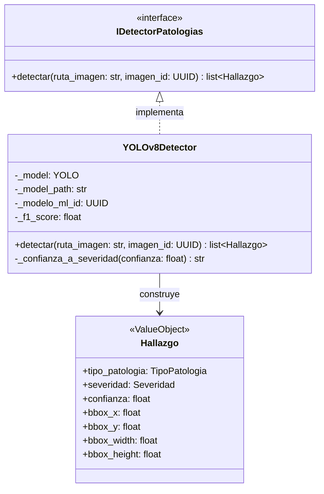
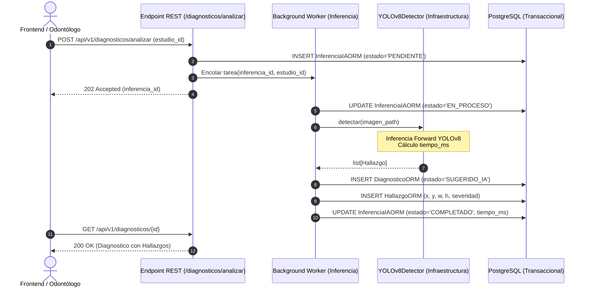

# Arquitectura del Sistema — Dental App Backend

**Sistema:** Sistema de Apoyo al Diagnóstico Odontológico para Detección de Caries en Fotografía Intraoral (CDSS)  
**Estilo Arquitectónico:** Arquitectura Limpia / Hexagonal (Ports & Adapters) con Domain-Driven Design (DDD) y CQRS Pragmático  
**Tecnología Principal:** Python 3.11+ / FastAPI / SQLAlchemy / PostgreSQL / Ultralytics YOLOv8  
**Versión:** 1.0.0  
**Fecha:** 2026-09-29  

---

## 1. Visión General del Sistema

El backend de **Dental App** está diseñado bajo los principios de desacoplamiento estricto, independencia de frameworks y modelado orientado al dominio clínico (*Domain-Driven Design*). La plataforma no trata a los modelos de inteligencia artificial como el núcleo del sistema, sino como **servicios de infraestructura intercambiables (adaptadores)** que implementan interfaces definidas en el dominio.

---

## 2. Bounded Contexts (Contextos Delimitados)

El dominio está particionado en 4 Bounded Contexts con fronteras de consistencia claras:

1. **BC-1: Pacientes (`app/domain/pacientes`):**
   * Responsabilidad: Gestión del registro civil del paciente (DNI de 8 dígitos, nombres, sexo, fecha de nacimiento).
   * Aggregate Root: `Paciente`.
2. **BC-2: Estudios Imagenológicos (`app/domain/estudios`):**
   * Responsabilidad: Agrupación de tomas fotográficas intraorales, validación de proyecciones anatómicas (`OCLUSAL_MANDIBULAR`, `FRONTAL_VESTIBULAR`, etc.) y deduplicación criptográfica vía hash SHA-256.
   * Aggregate Root: `Estudio`. Entidad interna: `ImagenIntraoral`.
3. **BC-3: Diagnóstico Clínico Asistido (`app/domain/diagnosticos`):**
   * Responsabilidad: Orquestación del ciclo de vida del diagnóstico (`SUGERIDO_IA` $\to$ `EN_REVISION` $\to$ `VALIDADO` / `RECHAZADO`), cuantificación de severidad y registro inmutable de auditoría forense.
   * Aggregate Root: `Diagnostico`. Entidad interna: `Hallazgo`.
4. **BC-4: Inferencia Técnica de IA (`app/domain/inferencias`):**
   * Responsabilidad: Trazabilidad del proceso de cómputo en segundo plano, métricas de hardware (`gpu_utilizada`, `tiempo_ms`) y catálogo de modelos autorizados (`modelos_ml`).
   * Entidades: `InferenciaIA`, `ModeloML`.

---

## 3. Estructura de Capas (Hexagonal)

### 3.1 Capa de Dominio (`app/domain/`)
* **Aislamiento Absoluto:** No importa librerías web (`FastAPI`, `starlette`), persistencia (`SQLAlchemy`) ni frameworks de deep learning (`ultralytics`, `torch`).
* **Value Objects Inmutables (`@dataclass(frozen=True)`):**
  * `TipoPatologia`: Controla que únicamente se evalúen patologías fotográficamente observables (`CARIES`, `FRACTURA`, `CALCULO_DENTAL`). Purgó conceptos radiológicos como `LESION_PERIAPICAL`.
  * `Severidad`: Categorías clínicas `LEVE`, `MODERADA` o `SEVERA`.
  * `RegionDental`: Define la localización espacial y cuadrante anatómico.
* **Puertos (Interfaces):**
  * `IDetectorPatologias`: Define el contrato abstracto `detectar(ruta_imagen) -> list[Hallazgo]`.
  * Interfaces de repositorio: `IRepositorioPacientes`, `IRepositorioEstudios`, `IRepositorioDiagnosticos`.

### 3.2 Capa de Aplicación (`app/application/`)
Implementa la orquestación del caso de uso mediante **CQRS Pragmático**:
* **Commands (Escritura):** Mutan el estado del sistema aplicando reglas del Aggregate Root.
  * `RegistrarPacienteCommand`
  * `CargarEstudioCommand`
  * `SolicitarAnalisisCommand`
  * `ValidarDiagnosticoCommand`
  * `RechazarDiagnosticoCommand`
* **Queries (Lectura):** Acceden a Read Models desacoplados optimizados para vistas del frontend sin recargar la jerarquía de agregados completos.

### 3.3 Capa de Infraestructura (`app/infrastructure/`)
Contiene los adaptadores secundarios que conectan el dominio con el software externo:
* **Base de Datos:** Mapeadores ORM SQLAlchemy (`app/infrastructure/database/models/`) y conexión en pool hacia PostgreSQL.
* **Adaptador de Visión Artificial (`YOLOv8Detector`):** Implementa el puerto `IDetectorPatologias`.

### 3.4 Capa de API / Presentación (`app/api/`)
* Expone los endpoints REST bajo el prefijo `/api/v1`.
* Realiza la deserialización y validación estricta de esquemas mediante Pydantic V2.
* Captura excepciones de dominio y las traduce a códigos HTTP semánticos (`400`, `404`, `409`, `422`).

---

## 4. El Patrón Adapter en Inferencia (`YOLOv8Detector`)

Para evitar que el dominio conozca los tensores de PyTorch o la librería `ultralytics`, se implementa el patrón **Adapter**:

### Proceso de Adaptación:
1. `YOLOv8Detector` recibe la ruta del archivo de imagen.
2. Invoca internamente `self._model.predict(source=ruta, conf=threshold, verbose=False)`.
3. Itera sobre los `Boxes` de Ultralytics, extrayendo las coordenadas normalizadas `xyxyn`.
4. Mapea las clases detectadas:
   * Clase `0` (`caries_permanente`) $\to$ `TipoPatologia("CARIES")` con metadato permanente.
   * Clase `1` (`caries_decidua`) $\to$ `TipoPatologia("CARIES")` con metadato deciduo.
5. Transforma la probabilidad numérica continua en la categoría de dominio `Severidad` (`SEVERA`, `MODERADA`, `LEVE`).
6. Retorna instancias puras del Value Object `Hallazgo`.

---

## 5. Ciclo de Vida del Worker Asíncrono de Inferencia

Para no degradar la experiencia de usuario ni agotar el pool de conexiones HTTP, la inferencia se orquesta de forma asíncrona:

---

## 6. Seguridad y Resiliencia en Persistencia

* **Conexiones:** SQLAlchemy Engine configurado con `pool_pre_ping=True` para detectar desconexiones silenciosas de PostgreSQL.
* **Transaccionalidad Atómica:** El patrón Unit of Work asegura que si falla la inserción de un hallazgo dentro de un diagnóstico, se realiza un `ROLLBACK` completo de la transacción, evitando diagnósticos huérfanos o parcialmente persistidos.
* **Integridad Referencial:** Claves foráneas con reglas estrictas: eliminación en cascada para imágenes asociadas a un estudio eliminado (`CASCADE`), pero restricción terminante de borrado si un modelo ML tiene diagnósticos generados (`RESTRICT`).
