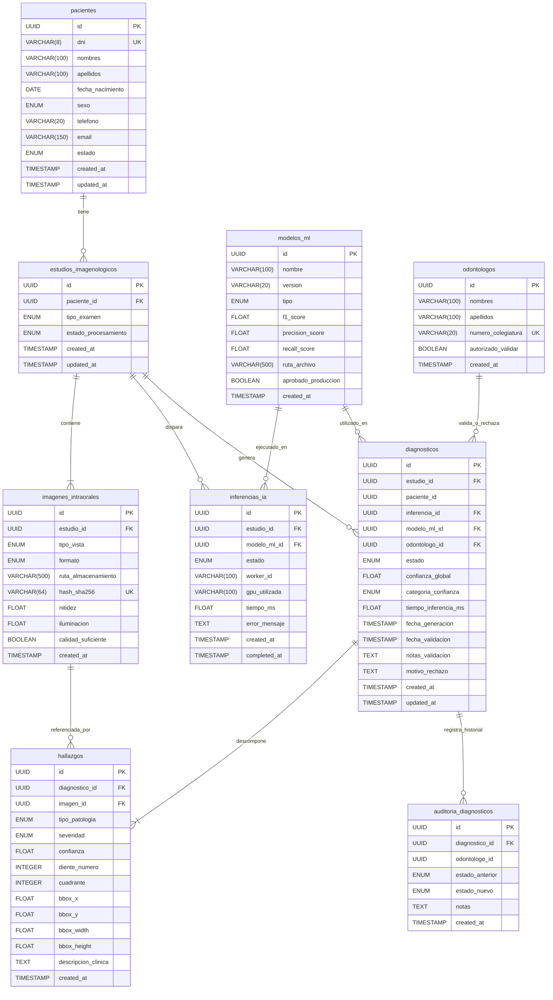

# Diccionario de Datos — Dental App Database

**Motor:** PostgreSQL 15+  
**ORM:** SQLAlchemy 2.0  
**Versión de Esquema:** 1.0.0  
**Fecha:** 2026-09-29  

---

## 1. Diagrama Entidad-Relación (ERD)

---

## 2. Catálogo Detallado de Tablas

### 2.1 Tabla: `pacientes`
Almacena el registro demográfico y civil de los pacientes que asisten a la consulta odontológica.

| Columna | Tipo de Dato | Nulo | Restricciones / Índices | Descripción |
| :--- | :--- | :--- | :--- | :--- |
| `id` | `UUID` | No | PK, Default: `uuid_generate_v4()` | Identificador universal único del paciente. |
| `dni` | `VARCHAR(8)` | No | UNIQUE, INDEX | Documento Nacional de Identidad (8 dígitos numéricos). |
| `nombres` | `VARCHAR(100)` | No | — | Nombres del paciente. |
| `apellidos` | `VARCHAR(100)` | No | — | Apellidos paterno y materno del paciente. |
| `fecha_nacimiento`| `TIMESTAMP WITH TIME ZONE` | No | — | Fecha de nacimiento para derivar edad y tipo de dentición. |
| `sexo` | `ENUM` (`sexo_enum`) | No | `'MASCULINO', 'FEMENINO', 'OTRO'` | Género biológico del paciente. |
| `telefono` | `VARCHAR(20)` | No | — | Teléfono de contacto del paciente. |
| `email` | `VARCHAR(150)` | Sí | — | Correo electrónico de contacto. |
| `estado` | `ENUM` (`estado_paciente_enum`) | No | Default: `'ACTIVO'` | Estado operativo (`'ACTIVO'`, `'INACTIVO'`). |
| `created_at` | `TIMESTAMP WITH TIME ZONE` | No | Default: `NOW()` | Marca temporal de creación del registro. |
| `updated_at` | `TIMESTAMP WITH TIME ZONE` | No | Default: `NOW()` | Marca temporal de última actualización. |

---

### 2.2 Tabla: `estudios_imagenologicos`
Representa una sesión o acto clínico de captura de fotografías intraorales asociado a un paciente.

| Columna | Tipo de Dato | Nulo | Restricciones / Índices | Descripción |
| :--- | :--- | :--- | :--- | :--- |
| `id` | `UUID` | No | PK, Default: `uuid_generate_v4()` | Identificador único del estudio. |
| `paciente_id` | `UUID` | No | FK $\to$ `pacientes(id)` (ON DELETE CASCADE), INDEX | Referencia al paciente asociado. |
| `tipo_examen` | `ENUM` (`tipo_examen_enum`) | No | Enum clínico fotográfico | Tipo de toma: `FOTOGRAFIA_INTRAORAL`, `SERIE_COMPLETA`, `OCLUSAL_MANDIBULAR`, `OCLUSAL_MAXILAR`, `FRONTAL_VESTIBULAR`, etc. |
| `estado_procesamiento` | `ENUM` (`estado_procesamiento_enum`) | No | Default: `'PENDIENTE'` | Estado: `'PENDIENTE'`, `'EN_ANALISIS'`, `'PROCESADO'`. |
| `created_at` | `TIMESTAMP WITH TIME ZONE` | No | Default: `NOW()` | Fecha y hora de apertura del estudio. |
| `updated_at` | `TIMESTAMP WITH TIME ZONE` | No | Default: `NOW()` | Fecha y hora de modificación. |

---

### 2.3 Tabla: `imagenes_intraorales`
Contiene los metadatos y la ubicación de las fotografías intraorales individuales.

| Columna | Tipo de Dato | Nulo | Restricciones / Índices | Descripción |
| :--- | :--- | :--- | :--- | :--- |
| `id` | `UUID` | No | PK, Default: `uuid_generate_v4()` | Identificador único de la fotografía. |
| `estudio_id` | `UUID` | No | FK $\to$ `estudios_imagenologicos(id)` (ON DELETE CASCADE), INDEX | Estudio al que pertenece la imagen. |
| `tipo_vista` | `ENUM` (`tipo_vista_enum`) | No | Proyección anatómica | `OCLUSAL_MANDIBULAR`, `OCLUSAL_MAXILAR`, `FRONTAL_VESTIBULAR`, `LATERAL_DERECHA`, `LATERAL_IZQUIERDA`. |
| `formato` | `ENUM` (`formato_imagen_enum`)| No | `'JPG', 'JPEG', 'PNG'` | Formato digital en luz visible (prohibido DICOM). |
| `ruta_almacenamiento`| `VARCHAR(500)` | No | — | Ruta relativa o URI física donde se almacena el archivo en disco. |
| `hash_sha256` | `VARCHAR(64)` | No | UNIQUE, INDEX | Digest criptográfico SHA-256 para deduplicación e integridad. |
| `nitidez` | `FLOAT` | Sí | — | Métrica estimada de nitidez (blur score). |
| `iluminacion` | `FLOAT` | Sí | — | Métrica estimada de nivel de exposición lumínica. |
| `calidad_suficiente`| `BOOLEAN` | No | Default: `True` | Flag de aptitud técnica para procesamiento por IA. |
| `created_at` | `TIMESTAMP WITH TIME ZONE` | No | Default: `NOW()` | Momento exacto de ingesta. |

---

### 2.4 Tabla: `inferencias_ia`
Trazabilidad técnica del proceso de inferencia asíncrono ejecutado por el worker.

| Columna | Tipo de Dato | Nulo | Restricciones / Índices | Descripción |
| :--- | :--- | :--- | :--- | :--- |
| `id` | `UUID` | No | PK, Default: `uuid_generate_v4()` | Identificador único del trabajo de inferencia. |
| `estudio_id` | `UUID` | No | FK $\to$ `estudios_imagenologicos(id)` (ON DELETE CASCADE), INDEX | Estudio procesado. |
| `modelo_ml_id` | `UUID` | No | FK $\to$ `modelos_ml(id)` (ON DELETE RESTRICT) | Modelo de Machine Learning utilizado. |
| `estado` | `ENUM` (`estado_inferencia_enum`)| No | Default: `'PENDIENTE'`, INDEX | `'PENDIENTE'`, `'EN_PROCESO'`, `'COMPLETADO'`, `'FALLIDO'`. |
| `worker_id` | `VARCHAR(100)` | Sí | — | Identificador del hilo/proceso que tomó la tarea. |
| `gpu_utilizada`| `VARCHAR(100)` | Sí | — | Nombre del acelerador hardware (ej. `'NVIDIA T4'`, `'Apple MPS'`, `'CPU'`). |
| `tiempo_ms` | `FLOAT` | Sí | — | Tiempo de inferencia cronometrado en milisegundos. |
| `error_mensaje`| `TEXT` | Sí | — | Detalle de la excepción técnica en caso de fallar. |
| `created_at` | `TIMESTAMP WITH TIME ZONE` | No | Default: `NOW()` | Encolamiento de la tarea. |
| `completed_at`| `TIMESTAMP WITH TIME ZONE` | Sí | — | Finalización de la inferencia. |

---

### 2.5 Tabla: `modelos_ml`
Catálogo de algoritmos y versiones de redes neuronales autorizadas en el sistema.

| Columna | Tipo de Dato | Nulo | Restricciones / Índices | Descripción |
| :--- | :--- | :--- | :--- | :--- |
| `id` | `UUID` | No | PK, Default: `uuid_generate_v4()` | Identificador único del registro de modelo. |
| `nombre` | `VARCHAR(100)` | No | — | Nombre comercial / descriptivo (ej. `'YOLOv8 Caries Baseline'`). |
| `version` | `VARCHAR(20)` | No | — | Etiqueta semántica de versión (ej. `'v1.0.0-colab'`). |
| `tipo` | `ENUM` (`tipo_modelo_enum`) | No | `'YOLO', 'SVM', 'RANDOM_FOREST', ...` | Familia algorítmica. |
| `f1_score` | `FLOAT` | No | — | F1-Score obtenido en validación/test ($F1 \ge 0.85$). |
| `precision_score`| `FLOAT` | No | — | Precisión macro sobre el test split. |
| `recall_score` | `FLOAT` | No | — | Sensibilidad macro sobre el test split. |
| `ruta_archivo` | `VARCHAR(500)` | No | — | Ruta al archivo de pesos (`.pt`, `.onnx`). |
| `aprobado_produccion`| `BOOLEAN` | No | Default: `False` | Habilita el consumo del modelo en producción. |
| `created_at` | `TIMESTAMP WITH TIME ZONE` | No | Default: `NOW()` | Fecha de registro en el catálogo. |

---

### 2.6 Tabla: `odontologos`
Profesionales facultados legalmente para la revisión y validación de diagnósticos.

| Columna | Tipo de Dato | Nulo | Restricciones / Índices | Descripción |
| :--- | :--- | :--- | :--- | :--- |
| `id` | `UUID` | No | PK, Default: `uuid_generate_v4()` | Identificador del odontólogo. |
| `nombres` | `VARCHAR(100)` | No | — | Nombres del profesional. |
| `apellidos` | `VARCHAR(100)` | No | — | Apellidos del profesional. |
| `numero_colegiatura`| `VARCHAR(20)` | No | UNIQUE | Número de matrícula o colegiatura odontológica oficial. |
| `autorizado_validar`| `BOOLEAN` | No | Default: `True` | Habilitación profesional para emitir firmas diagnósticas. |
| `created_at` | `TIMESTAMP WITH TIME ZONE` | No | Default: `NOW()` | Fecha de alta en el sistema. |

---

### 2.7 Tabla: `diagnosticos`
Aggregate Root central del diagnóstico asistido por IA.

| Columna | Tipo de Dato | Nulo | Restricciones / Índices | Descripción |
| :--- | :--- | :--- | :--- | :--- |
| `id` | `UUID` | No | PK, Default: `uuid_generate_v4()` | Identificador único del diagnóstico. |
| `estudio_id` | `UUID` | No | FK $\to$ `estudios_imagenologicos(id)` (ON DELETE CASCADE), INDEX | Estudio evaluado. |
| `paciente_id` | `UUID` | No | INDEX | Paciente (desnormalizado por rendimiento CQRS). |
| `inferencia_id`| `UUID` | Sí | FK $\to$ `inferencias_ia(id)` (ON DELETE SET NULL) | Proceso técnico de IA que sugirió el diagnóstico. |
| `modelo_ml_id` | `UUID` | No | FK $\to$ `modelos_ml(id)` (ON DELETE RESTRICT) | Modelo generador de las sugerencias. |
| `odontologo_id`| `UUID` | Sí | FK $\to$ `odontologos(id)` (ON DELETE SET NULL) | Odontólogo que emitió la validación o rechazo. |
| `estado` | `ENUM` (`estado_diagnostico_enum`)| No | Default: `'SUGERIDO_IA'`, INDEX | `'SUGERIDO_IA'`, `'EN_REVISION'`, `'VALIDADO'`, `'RECHAZADO'`. |
| `confianza_global`| `FLOAT` | No | — | Confianza agregada del modelo sobre el estudio. |
| `categoria_confianza`| `ENUM` (`categoria_confianza_enum`)| No | `'BAJA', 'MEDIA', 'ALTA'` | Clasificación cualitativa de certeza. |
| `tiempo_inferencia_ms`| `FLOAT` | Sí | — | Copia de tiempo de cómputo para auditoría rápida. |
| `fecha_generacion`| `TIMESTAMP WITH TIME ZONE` | No | — | Momento en que la IA generó las sugerencias. |
| `fecha_validacion`| `TIMESTAMP WITH TIME ZONE` | Sí | — | Momento en que el odontólogo validó o rechazó. |
| `notas_validacion`| `TEXT` | Sí | — | Observaciones clínicas del odontólogo humano. |
| `motivo_rechazo` | `TEXT` | Sí | — | Sustento clínico obligatorio en caso de rechazo. |
| `created_at` | `TIMESTAMP WITH TIME ZONE` | No | Default: `NOW()` | Creación del registro. |
| `updated_at` | `TIMESTAMP WITH TIME ZONE` | No | Default: `NOW()` | Modificación del registro. |

---

### 2.8 Tabla: `hallazgos`
Detecciones puntuales de patología encontradas por la red en una fotografía concreta.

| Columna | Tipo de Dato | Nulo | Restricciones / Índices | Descripción |
| :--- | :--- | :--- | :--- | :--- |
| `id` | `UUID` | No | PK, Default: `uuid_generate_v4()` | Identificador del hallazgo. |
| `diagnostico_id`| `UUID` | No | FK $\to$ `diagnosticos(id)` (ON DELETE CASCADE), INDEX | Diagnóstico al que pertenece. |
| `imagen_id` | `UUID` | No | FK $\to$ `imagenes_intraorales(id)` (ON DELETE CASCADE) | Fotografía donde se ubica la lesión. |
| `tipo_patologia`| `ENUM` (`tipo_patologia_enum`)| No | `'CARIES', 'FRACTURA', 'CALCULO_DENTAL'` | Patología detectada. |
| `severidad` | `ENUM` (`severidad_enum`) | No | `'LEVE', 'MODERADA', 'SEVERA'` | Grado de severidad clínica estimado. |
| `confianza` | `FLOAT` | No | — | Puntuación de probabilidad normalizada $[0.0, 1.0]$. |
| `diente_numero`| `INTEGER` | Sí | — | Notación FDI internacional de la pieza dental. |
| `cuadrante` | `INTEGER` | Sí | — | Cuadrante anatómico oral (1 al 4 permanente, 5 al 8 deciduo). |
| `bbox_x` | `FLOAT` | Sí | — | Coordenada $x_1$ de la caja normalizada $[0.0, 1.0]$. |
| `bbox_y` | `FLOAT` | Sí | — | Coordenada $y_1$ de la caja normalizada $[0.0, 1.0]$. |
| `bbox_width` | `FLOAT` | Sí | — | Ancho relativo normalizado de la caja $[0.0, 1.0]$. |
| `bbox_height`| `FLOAT` | Sí | — | Alto relativo normalizado de la caja $[0.0, 1.0]$. |
| `descripcion_clinica`| `TEXT` | Sí | — | Descripción textual auxiliar generada. |
| `created_at` | `TIMESTAMP WITH TIME ZONE` | No | Default: `NOW()` | Marca temporal de detección. |

---

### 2.9 Tabla: `auditoria_diagnosticos`
Bitácora de eventos clínicos inmutables (*append-only*).

| Columna | Tipo de Dato | Nulo | Restricciones / Índices | Descripción |
| :--- | :--- | :--- | :--- | :--- |
| `id` | `UUID` | No | PK, Default: `uuid_generate_v4()` | Identificador del evento de auditoría. |
| `diagnostico_id`| `UUID` | No | FK $\to$ `diagnosticos(id)` (ON DELETE CASCADE), INDEX | Diagnóstico auditado. |
| `odontologo_id`| `UUID` | Sí | — | Identificador del profesional que provocó la transición. |
| `estado_anterior`| `ENUM` (`estado_diag_audit_enum`)| No | `'SUGERIDO_IA', 'EN_REVISION', ...` | Estado previo a la mutación. |
| `estado_nuevo` | `ENUM` (`estado_diag_audit_enum`)| No | `'VALIDADO', 'RECHAZADO', ...` | Estado resultante tras la acción. |
| `notas` | `TEXT` | Sí | — | Notas explicativas asociadas al cambio de estado. |
| `created_at` | `TIMESTAMP WITH TIME ZONE` | No | Default: `NOW()` | Timestamp UTC inalterable del evento. |
