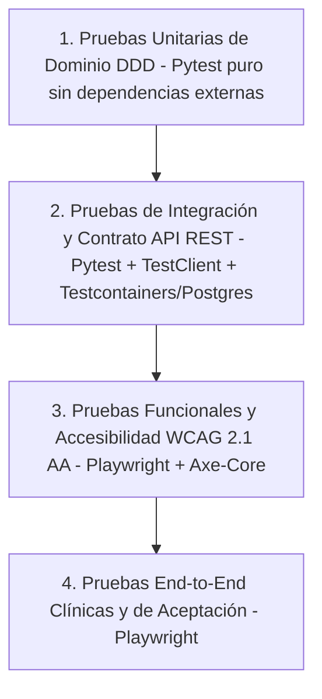

# Especificación Integral y Matriz de Casos de Prueba (test-cases.md)
## Sistema de Apoyo al Diagnóstico Odontológico para Detección de Caries (CDSS)

**Estándares de Referencia:**  
* **ISO/IEC/IEEE 29119:** Software Testing (Conceptos, Procesos y Documentación de Pruebas)  
* **ISO/IEC 25010:2011:** Systems and software Quality Requirements and Evaluation (SQuaRE)  
* **W3C WCAG 2.1 / 2.2 Nivel AA:** Web Content Accessibility Guidelines (Accesibilidad Clínica - a11y)  
* **ISO 27799 / HIPAA:** Seguridad y Privacidad de la Información en Salud  

**Versión del Documento:** 1.0.0  
**Fecha:** 2026-10-26  
**Stack de Evaluación:** Pytest (Unit / Integration) + Playwright & `@axe-core/playwright` (E2E & a11y) + Locust / Apache Bench (Performance)  

---

## 1. Resumen Ejecutivo y Pirámide de Pruebas

El presente documento consolida **todos los niveles y tipos de prueba** del sistema en una única especificación técnica y clínica unificada:



| Nivel de Prueba | Alcance y Tecnologías | Criterio de Aceptación Global |
| :--- | :--- | :--- |
| **Unitarias (Dominio)** | Value Objects, Entidades y Agregados (`pytest`). | 100% de reglas de negocio validadas sin base de datos ni red. |
| **Integración (Backend)** | Routers FastAPI, Repositorios SQLAlchemy, Worker Asíncrono ML y PostgreSQL. | Códigos de estado HTTP correctos (`200`, `201`, `202`, `404`, `409`, `422`). Cero errores `500`. |
| **Funcionales y Accesibilidad (a11y)** | Frontend React + Playwright + `@axe-core/playwright`. | Cumplimiento WCAG 2.1 AA. Cero violaciones críticas o serias. Operabilidad 100% por teclado. |
| **Seguridad e Idempotencia** | Sanitización EXIF, no repudio SHA-256, RBAC odontológico y tablas *append-only*. | Integridad forense inalterable y protección de datos médicos. |
| **Rendimiento** | Latencia de inferencia YOLOv8, percentil $p95$ de endpoints REST y concurrencia. | GPU $\le 300\text{ ms}$, CPU $\le 1,500\text{ ms}$, API $p95 < 200\text{ ms}$. |
| **End-to-End (E2E)** | Ciclo de vida completo desde admisión del paciente hasta firma del diagnóstico. | Transición correcta de estados clínicos sin bloqueos de interfaz. |

---

## 2. Módulo 1: Pruebas Unitarias de Dominio (BC-01 Pacientes & BC-02 Estudios)

### 2.1 Gestión de Pacientes (`app/domain/pacientes/`)

| ID | Requerimiento | Componente / VO | Precondición | Datos de Entrada | Pasos de Ejecución | Resultado Esperado | Prioridad |
| :--- | :--- | :--- | :--- | :--- | :--- | :--- | :--- |
| **TC-UNIT-PAC-01** | RF-PAC-01 | `DNI` | Ninguna. | `value="75415745"` | Instanciar `DNI(value)`. | Instancia válida generada sin excepción. | **P1 (Crítica)** |
| **TC-UNIT-PAC-02** | RF-PAC-01 | `DNI` | Ninguna. | `value=""`, `value="   "` | Instanciar `DNI(value)`. | Lanza `ValueError("El DNI no puede estar vacío.")`. | **P1 (Crítica)** |
| **TC-UNIT-PAC-03** | RF-PAC-01 | `DNI` | Ninguna. | `value="7541A745"` | Instanciar `DNI(value)`. | Lanza `ValueError("El DNI debe contener solo dígitos.")`. | **P1 (Crítica)** |
| **TC-UNIT-PAC-04** | RF-PAC-01 | `DNI` | Ninguna. | `value="123456789"` (9 dígitos) | Instanciar `DNI(value)`. | Lanza `ValueError("El DNI no puede superar 8 dígitos.")`. | **P1 (Crítica)** |
| **TC-UNIT-PAC-05** | RF-PAC-02 | `Telefono` | Ninguna. | `value="964235456"` | Instanciar `Telefono(value)`. | Instancia válida para celular peruano (9 dígitos empezando en 9). | **P2 (Alta)** |
| **TC-UNIT-PAC-06** | RF-PAC-02 | `Telefono` | Ninguna. | `value="+51964235456"` | Instanciar `Telefono(value)`. | Instancia válida para formato internacional con prefijo `+`. | **P2 (Alta)** |
| **TC-UNIT-PAC-07** | RF-PAC-02 | `Telefono` | Ninguna. | `value="12345"` | Instanciar `Telefono(value)`. | Lanza `ValueError("Formato de teléfono inválido.")`. | **P2 (Alta)** |
| **TC-UNIT-PAC-08** | RF-PAC-03 | `Email` | Ninguna. | `value="guisan23@gmail.com"`, `value="guillermo.sanchez@clinica.pe"` | Instanciar `Email(value)`. | Instancia válida creada (soporta puntos en el nombre de usuario). | **P2 (Alta)** |
| **TC-UNIT-PAC-09** | RF-PAC-03 | `Email` | Ninguna. | `value="correo-sin-arroba"` | Instanciar `Email(value)`. | Lanza `ValueError("Correo inválido: '...'")`. | **P2 (Alta)** |
| **TC-UNIT-PAC-10** | RF-PAC-04 | `Sexo` | Ninguna. | `value="M"`, `value="F"`, `value="OTRO"` | Instanciar `Sexo(value)`. | Instancia válida con valores canónicos de dominio. | **P2 (Alta)** |
| **TC-UNIT-PAC-11** | RF-PAC-04 | `Sexo` | Ninguna. | `value="MASCULINO"`, `value="FEMENINO"` | Instanciar `Sexo(value)`. | Normaliza automáticamente a `"M"` y `"F"` respectivamente. | **P2 (Alta)** |
| **TC-UNIT-PAC-12** | RF-PAC-04 | `Sexo` | Ninguna. | `value="INVALIDO"` | Instanciar `Sexo(value)`. | Lanza `ValueError` indicando valores permitidos. | **P2 (Alta)** |
| **TC-UNIT-PAC-13** | RF-PAC-05 | `NombreCompleto` | Ninguna. | `nombres="Guillermo"`, `apellidos="Sánchez"` | `NombreCompleto.completo()`. | Retorna string concatenada `"Guillermo Sánchez"`. | **P3 (Media)** |
| **TC-UNIT-PAC-14** | RF-PAC-05 | `NombreCompleto` | Ninguna. | `nombres=""` o `apellidos=""` | Instanciar `NombreCompleto`. | Lanza `ValueError` indicando campo obligatorio. | **P2 (Alta)** |

### 2.2 Adquisición Imagenológica (`app/domain/estudios/`)

| ID | Requerimiento | Componente / VO | Precondición | Datos de Entrada | Pasos de Ejecución | Resultado Esperado | Prioridad |
| :--- | :--- | :--- | :--- | :--- | :--- | :--- | :--- |
| **TC-UNIT-EST-01** | RF-01 | `FormatoImagen` | Ninguna. | `value="jpg"`, `value="png"`, `value="JPEG"` | Instanciar `FormatoImagen(value)`. | Instancia válida para formatos ópticos fotográficos. | **P2 (Alta)** |
| **TC-UNIT-EST-02** | RF-01 | `FormatoImagen` | Ninguna. | `value="dcm"`, `value="dicom"`, `value="pdf"` | Instanciar `FormatoImagen(value)`. | Lanza `ValueError("Formato inválido...")` (rechazo explícito de DICOM). | **P1 (Crítica)** |
| **TC-UNIT-EST-03** | RF-02 | `HashSHA256` | Ninguna. | `value="fd689600b53526bc21db1bdfd7c656e5b7413a183644a4ea1c68052fb1d46dca"` | Instanciar `HashSHA256(value)`. | Instancia válida creada (64 caracteres hexadecimales). | **P1 (Crítica)** |
| **TC-UNIT-EST-04** | RF-02 | `HashSHA256` | Ninguna. | `value="invalido"`, `value="zzzz..."` | Instanciar `HashSHA256(value)`. | Lanza `ValueError` por longitud distinta de 64 o caracteres no hexadecimales. | **P1 (Crítica)** |
| **TC-UNIT-EST-05** | RF-01 | `TipoVista` | Ninguna. | `value="OCLUSAL_MANDIBULAR"`, `value="OCLUSAL_MAXILAR"` | Instanciar `TipoVista(value)`. | Instancia válida creada. | **P2 (Alta)** |
| **TC-UNIT-EST-06** | RNF-05 | `CalidadImagen` | Ninguna. | `nitidez=0.92`, `iluminacion=0.88`, `suficiente=True` | Instanciar `CalidadImagen(...)`. | Instancia válida creada dentro del rango $[0.0, 1.0]$. | **P2 (Alta)** |
| **TC-UNIT-EST-07** | RNF-05 | `CalidadImagen` | Ninguna. | `nitidez=1.5` o `iluminacion=-0.1` | Instanciar `CalidadImagen(...)`. | Lanza `ValueError` por estar fuera del rango normalizado $[0.0, 1.0]$. | **P2 (Alta)** |
| **TC-UNIT-EST-08** | RF-01 | `EstudioImagenologico` | Agregado instanciado con 10 imágenes. | Intentar añadir imagen número 11. | Invocar `estudio.agregar_imagen(img_11)`. | Lanza `DomainException("Un estudio no puede contener más de 10 imágenes.")`. | **P1 (Crítica)** |

---

## 3. Módulo 2: Pruebas de Integración Backend (API REST & Base de Datos)

| ID | Requerimiento | Endpoint | Precondición | Payload / Parámetros | Resultado Esperado | Prioridad |
| :--- | :--- | :--- | :--- | :--- | :--- | :--- |
| **TC-INT-PAC-01** | RF-PAC-04 | `POST /api/v1/pacientes/` | Base de datos activa sin DNI 75415745. | `{"dni": "75415745", "nombres": "Guillermo", "apellidos": "Sánchez", "fecha_nacimiento": "2026-09-29", "sexo": "M", "telefono": "964235456", "email": "guisan23@gmail.com"}` | HTTP `201 Created`, retorna `{"id": "<uuid>"}`, persistido en BD con sexo `MASCULINO`. | **P1 (Crítica)** |
| **TC-INT-PAC-02** | RF-PAC-04 | `POST /api/v1/pacientes/` | Paciente con DNI 75415745 ya registrado. | Reenvío del mismo payload con DNI 75415745. | HTTP `409 Conflict`, detalle: `"Ya existe un paciente registrado con el DNI '75415745'."`. | **P1 (Crítica)** |
| **TC-INT-PAC-03** | RF-PAC-04 | `GET /api/v1/pacientes/` | Al menos 1 paciente activo en BD. | Parámetros: `?limit=10&offset=0`. | HTTP `200 OK`, lista de pacientes con sexo mapeado a `"M"` / `"F"` / `"OTRO"`. | **P2 (Alta)** |
| **TC-INT-EST-01** | RF-01 | `POST /api/v1/estudios/` | Paciente existente en BD. | `{"paciente_id": "<uuid>", "tipo_examen": "OCLUSAL_MANDIBULAR"}` | HTTP `201 Created`, retorna ID del estudio con estado `PENDIENTE`. | **P1 (Crítica)** |
| **TC-INT-EST-02** | RF-01 | `GET /api/v1/estudios/{id}` | Estudio registrado. | ID del estudio generado. | HTTP `200 OK`, retorna datos del estudio e imágenes asociadas. Cero errores `TypeError: tipo_examer`. | **P1 (Crítica)** |
| **TC-INT-IMG-01** | RF-01 | `POST /api/v1/estudios/{id}/imagenes` | Estudio existente en estado `PENDIENTE`. | Payload completo con `tipo_vista`, `hash_sha256`, `calidad_suficiente: true`. | HTTP `201 Created`, retorna `{"id": "<imagen_id>"}`, imagen persistida en disco y BD. | **P1 (Crítica)** |
| **TC-INT-IMG-02** | RF-02 | `POST /api/v1/estudios/{id}/imagenes` | Imagen con hash `H1` previamente guardada. | Intento de registrar otra imagen con el mismo hash `H1`. | HTTP `409 Conflict`, rechazo por deduplicación determinista. | **P1 (Crítica)** |
| **TC-INT-IA-01** | RF-03 | `POST /api/v1/estudios/{id}/analisis` | Estudio con imágenes registradas. | `{"modelo_id": "<uuid_modelo>"}` | HTTP `202 Accepted` en $<150\text{ ms}$, retorna `inferencia_id`, estudio pasa a `EN_ANALISIS`. | **P1 (Crítica)** |
| **TC-INT-DX-01** | RF-06 | `POST /api/v1/diagnosticos/{id}/validar` | Odontólogo con `autorizado_validar=True`. | `{"odontologo_id": "<uuid>", "notas_validacion": "Confirmada caries oclusal"}` | HTTP `200 OK`, diagnóstico pasa a `VALIDADO`, genera fila en `auditoria_diagnosticos`. | **P1 (Crítica)** |
| **TC-INT-DX-02** | RF-06 | `POST /api/v1/diagnosticos/{id}/rechazar` | Diagnóstico en revisión. | `{"odontologo_id": "<uuid>", "motivo_rechazo": "Falso positivo por sombra de cúspide"}` | HTTP `200 OK`, diagnóstico pasa a `RECHAZADO`, registra motivo en auditoría. | **P1 (Crítica)** |

---

## 4. Módulo 3: Pruebas Funcionales y de Accesibilidad Clínica (Playwright + Axe-Core)

*Estándar de Evaluación:* **WCAG 2.1 Nivel AA**  
*Herramientas:* `@playwright/test` + `@axe-core/playwright`  

### 4.1 Casos de Prueba Funcionales y de Accesibilidad (a11y)

| ID | Criterio WCAG | Vista / Componente | Precondición | Acción / Entrada | Criterio de Aceptación | Prioridad |
| :--- | :--- | :--- | :--- | :--- | :--- | :--- |
| **TC-A11Y-01** | **SC 1.3.1 Info & Relationships** | Modal `PacienteForm.jsx` | Modal "Registrar Paciente" abierto. | Inyección de AxeBuilder sobre el modal. | Cero violaciones críticas o serias. Cada `<input>` tiene `<label>` asociado mediante `htmlFor` o anidación explícita. | **P1 (Crítica)** |
| **TC-A11Y-02** | **SC 2.1.1 Keyboard Navigation** | Modal `PacienteForm.jsx` | Foco en campo DNI. | Presionar tecla `Tab` secuencialmente por todos los campos. | Foco visible (`ring-2 focus:outline-none`) en todos los controles sin bloqueos ni saltos ilógicos. | **P1 (Crítica)** |
| **TC-A11Y-03** | **SC 2.1.2 No Keyboard Trap** | Modal `PacienteForm.jsx` | Foco dentro del modal. | Presionar tecla `Escape`. | El modal se cierra de inmediato y retorna el foco al botón disparador en la lista principal. | **P2 (Alta)** |
| **TC-A11Y-04** | **SC 3.3.1 Error Identification** | Modal `PacienteForm.jsx` | Formulario enviado en blanco. | Presionar "Registrar Paciente". | Los errores se asocian con `role="alert"` y los campos inválidos tienen `aria-invalid="true"`. | **P1 (Crítica)** |
| **TC-A11Y-05** | **SC 1.4.3 Contrast (Minimum)** | Formulario y Alertas | Textos de error en pantalla. | Escaneo cromático con Axe-Core. | Contraste de texto $\ge 4.5:1$ sobre fondo adyacente (texto rose-600 sobre fondos claros). | **P2 (Alta)** |
| **TC-A11Y-06** | **SC 2.1.1 Keyboard File Upload** | `ImagenUploader.jsx` | Dropzone visible sin archivo. | Navegar con `Tab` al dropzone (`data-testid="uploader-dropzone"`) y pulsar `Enter` o `Espacio`. | Se dispara el explorador de archivos del sistema operativo sin requerir clic del mouse. | **P1 (Crítica)** |
| **TC-A11Y-07** | **SC 4.1.3 Status Messages** | `ImagenUploader.jsx` | Cálculo de hash en progreso. | Esperar resolución de Web Crypto API. | Contenedor con `aria-live="polite"` anuncia: *"Archivo verificado (integridad clínica certificada)"* sin filtrar hash hexadecimal crudo. | **P2 (Alta)** |
| **TC-A11Y-08** | **SC 1.1.1 Non-text Content** | `ImagenUploader.jsx` | Fotografía intraoral previsualizada. | Inspeccionar elemento ``. | El atributo `alt` describe el archivo clínico (`alt="Vista previa de fotografía intraoral: ..."`). | **P2 (Alta)** |
| **TC-A11Y-09** | **SC 1.4.11 Non-text Contrast** | `ImagenUploader.jsx` | Badge de verificación activo. | Evaluar icono `CheckCircle` verde y bordes. | Contraste de interfaz de usuario $\ge 3:1$ respecto al fondo. | **P3 (Media)** |
| **TC-A11Y-10** | **SC 1.1.1 Non-text Content** | Visor de Detecciones | Bounding boxes de caries renderizados. | Inspeccionar capas SVG/Canvas. | Cada caja delimitadora posee `aria-label` descriptivo indicando pieza dental, severidad y certeza. | **P1 (Crítica)** |
| **TC-A11Y-11** | **SC 1.4.11 Contrast of Overlays** | Visor de Detecciones | Bounding box sobre esmalte dental. | Evaluar visibilidad del contorno de detección. | El trazo de la caja delimitadora utiliza contorno bicolor de alto contraste visible sobre fondos claros y oscuros. | **P1 (Crítica)** |
| **TC-A11Y-12** | **SC 3.3.2 Labels or Instructions** | Panel de Firma Odontológica | Panel de validación abierto. | Inspeccionar formulario de firma. | Campos obligatorios identificados mediante `aria-required="true"`. Campo de motivo de rechazo claramente etiquetado. | **P1 (Crítica)** |

### 4.2 Suite Automatizada de Ejemplo (Playwright + Axe)

```typescript
// tests/e2e/accessibility.spec.ts
import { test, expect } from '@playwright/test';
import AxeBuilder from '@axe-core/playwright';

test.describe('A11Y: Validación de Accesibilidad Clínica WCAG 2.1 AA', () => {

  test('Modal de Pacientes libre de violaciones críticas y serias', async ({ page }) => {
    await page.goto('/pacientes');
    await page.getByRole('button', { name: /nuevo paciente/i }).click();

    const scanResults = await new AxeBuilder({ page })
      .include('form')
      .withTags(['wcag2a', 'wcag2aa', 'wcag21aa'])
      .analyze();

    const criticalViolations = scanResults.violations.filter(
      (v) => v.impact === 'critical' || v.impact === 'serious'
    );
    expect(criticalViolations).toEqual([]);
  });

  test('Carga de imagen intraoral operable por teclado con región ARIA en vivo', async ({ page }) => {
    await page.goto('/estudios/nuevo');

    const dropzone = page.getByTestId('uploader-dropzone');
    await dropzone.focus();
    await expect(dropzone).toBeFocused();

    // Simular carga de archivo accesible
    const fileChooserPromise = page.waitForEvent('filechooser');
    await page.keyboard.press('Enter');
    const fileChooser = await fileChooserPromise;
    await fileChooser.setFiles({
      name: 'foto_clinica.jpg',
      mimeType: 'image/jpeg',
      buffer: Buffer.from('fake-optical-image-bytes'),
    });

    // Validar anuncio accesible de integridad
    const ariaLiveRegion = page.locator('[aria-live="polite"]');
    await expect(ariaLiveRegion).toContainText(/Archivo verificado/i);
  });
});
```

---

## 5. Módulo 4: Pruebas de Machine Learning y Modelo de IA (BC-03)

| ID | Requerimiento | Criterio Evaluado | Precondición | Procedimiento | Resultado Esperado | Prioridad |
| :--- | :--- | :--- | :--- | :--- | :--- | :--- |
| **TC-ML-01** | RNF-02 | $F1\text{-Score} \ge 0.85$ | Test set independiente (sin fuga de datos de entrenamiento). | Evaluar métrica global de YOLOv8 sobre conjunto de prueba etiquetado por odontólogos. | $F1\text{-Score} \ge 0.85$ para permitir `aprobado_produccion = True`. | **P1 (Crítica)** |
| **TC-ML-02** | RNF-02 | Sensibilidad / Recall $\ge 0.90$ | Test set de caries en dentición permanente. | Calcular matriz de confusión para clase 0 (`caries_permanente`). | $\text{Recall} \ge 0.90$ para minimizar falsos negativos críticos en salud pública. | **P1 (Crítica)** |
| **TC-ML-03** | RNF-04 | Determinismo Algorítmico | Misma imagen $I$, mismo umbral $\tau^*=0.40$. | Ejecutar inferencia 3 veces consecutivas con `model.eval()` y `torch.no_grad()`. | Idénticas coordenadas $[x_1, y_1, x_2, y_2]$ y confianza hasta el 4º decimal en las 3 ejecuciones. | **P1 (Crítica)** |
| **TC-ML-04** | RF-04 | Normalización de Coordenadas | Inferencia completada. | Validar rango de bounding boxes en la entidad `Hallazgo`. | $x_1, y_1, \text{width}, \text{height} \in [0.0, 1.0]$ sin deformación de coordenadas relativas. | **P1 (Crítica)** |
| **TC-ML-05** | RF-04 | Gradación de Severidad | Confianza $\ge 0.80$. | Mapear hallazgo clínico. | Severidad asignada: `SEVERA`. | **P2 (Alta)** |
| **TC-ML-06** | RF-04 | Gradación de Severidad | Confianza entre $0.55$ y $0.79$. | Mapear hallazgo clínico. | Severidad asignada: `MODERADA`. | **P2 (Alta)** |
| **TC-ML-07** | RF-04 | Gradación de Severidad | Confianza $< 0.55$. | Mapear hallazgo clínico. | Severidad asignada: `LEVE`. | **P2 (Alta)** |

---

## 6. Módulo 5: Seguridad, Privacidad y Auditoría Inmutable (RNF-03, RF-07)

| ID | Requerimiento | Nivel / Tipo | Precondición | Prueba / Ataque Simulado | Resultado Esperado | Prioridad |
| :--- | :--- | :--- | :--- | :--- | :--- | :--- |
| **TC-SEC-01** | RNF-03 | Privacidad Médica | Imagen con metadatos EXIF que contienen coordenadas GPS de clínica y paciente. | Ingesta y almacenamiento de la imagen en disco. | La imagen guardada en almacenamiento persistente carece de tags EXIF con geolocalización o datos personales incrustados. | **P1 (Crítica)** |
| **TC-SEC-02** | RNF-03 | Configuración | Entorno de producción (`docker-compose.prod.yaml`). | Inspección de variables de entorno del contenedor. | `DEBUG=False`, `SECRET_KEY` no utiliza defaults del repositorio y tiene entropía adecuada. | **P1 (Crítica)** |
| **TC-SEC-03** | RNF-03 | Seguridad CORS | API en producción. | Petición HTTP desde origen ajeno (`http://malicious-origin.com`). | Rechazo por política CORS; encabezado `Access-Control-Allow-Origin` no coincide. | **P1 (Crítica)** |
| **TC-SEC-04** | RF-07 | Auditoría (*Append-Only*) | Registro existente en tabla `auditoria_diagnosticos`. | Intento de ejecución SQL: `UPDATE auditoria_diagnosticos SET ...`. | Operación abortada por permisos de base de datos o disparador de inmutabilidad. | **P1 (Crítica)** |
| **TC-SEC-05** | RF-07 | Auditoría (*Append-Only*) | Registro existente en tabla `auditoria_diagnosticos`. | Intento de ejecución SQL: `DELETE FROM auditoria_diagnosticos WHERE ...`. | Operación abortada. Prohibido el borrado de registros de auditoría médica. | **P1 (Crítica)** |
| **TC-SEC-06** | RF-06 | Firma Colegiada | Usuario autenticado sin rol de Odontólogo o con `autorizado_validar=False`. | Intento de validación o rechazo de diagnóstico vía API. | HTTP `403 Forbidden`. La firma diagnóstica está estrictamente restringida a profesionales habilitados. | **P1 (Crítica)** |

---

## 7. Módulo 6: Rendimiento y Comportamiento Temporal (RNF-01)

| ID | Requerimiento | Tipo de Prueba | Entorno | Carga / Entrada | Criterio de Aceptación | Prioridad |
| :--- | :--- | :--- | :--- | :--- | :--- | :--- |
| **TC-PERF-01** | RNF-01 | Latencia Inferencia GPU | Servidor con GPU dedicada NVIDIA (CUDA). | Fotografía intraoral estándar $640 \times 640$. | Tiempo de inferencia visual $\le 300\text{ ms}$. | **P2 (Alta)** |
| **TC-PERF-02** | RNF-01 | Latencia Inferencia CPU | PC local / Servidor sin GPU acelerada. | Fotografía intraoral estándar $640 \times 640$. | Tiempo de inferencia visual $\le 1,500\text{ ms}$. | **P2 (Alta)** |
| **TC-PERF-03** | RNF-01 | Rendimiento REST API | PostgreSQL en Docker. | 20 usuarios concurrentes realizando consultas CQRS (`GET /pacientes`, `GET /estudios`). | Percentil $p95 < 200\text{ ms}$ en todas las respuestas durante 10 minutos de prueba continua. | **P2 (Alta)** |
| **TC-PERF-04** | RNF-01 | Desacoplamiento Asíncrono | Servidor Uvicorn bajo carga normal. | `POST /api/v1/estudios/{id}/analisis`. | Conexión HTTP liberada en menos de **$150\text{ ms}$** con código `202 Accepted`. | **P2 (Alta)** |

---

## 8. Módulo 7: Pruebas End-to-End Clínicas (Flujo Completo)

| ID | Flujo Clínico Evaluado | Pasos de Ejecución | Criterio de Éxito | Prioridad |
| :--- | :--- | :--- | :--- | :--- |
| **TC-E2E-01** | **Admisión del Paciente** | 1. Clic en "Nuevo Paciente".<br>2. Completar formulario con DNI `75415745` y datos válidos.<br>3. Confirmar registro. | Paciente aparece en la lista con estado `ACTIVO`. Base de datos almacena el registro con sexo `MASCULINO`. Cero recargas de página. | **P1 (Crítica)** |
| **TC-E2E-02** | **Creación de Estudio y Carga de Fotografía** | 1. Seleccionar paciente admitido.<br>2. Crear nuevo estudio.<br>3. Arrastrar fotografía intraoral a `ImagenUploader`.<br>4. Esperar verificación silenciosa SHA-256 (badge verde).<br>5. Confirmar carga de imagen. | Estudio creado con estado `PENDIENTE`. Imagen registrada con hash SHA-256 persistida sin fugas de errores `500`. | **P1 (Crítica)** |
| **TC-E2E-03** | **Análisis IA No Bloqueante** | 1. Clic en "Solicitar Análisis IA".<br>2. UI muestra estado `EN_ANALISIS`.<br>3. Worker procesa imagen en background.<br>4. UI actualiza reactivamente a `SUGERIDO_IA`. | Visor despliega bounding boxes con severidad (`LEVE`, `MODERADA`, `SEVERA`) y grado de certeza. | **P1 (Crítica)** |
| **TC-E2E-04** | **Revisión y Firma Odontológica** | 1. Odontólogo colegiado revisa hallazgos.<br>2. Ingresa notas clínicas de confirmación.<br>3. Clic en "Aprobar y Firmar Diagnóstico". | Diagnóstico pasa a `VALIDADO`. Se bloquea cualquier edición posterior (irreversible) y se genera registro inmutable en auditoría. | **P1 (Crítica)** |

---

## 9. Matriz de Trazabilidad: Requerimientos vs. Casos de Prueba

| Requerimiento del Sistema | Historia de Usuario | Casos de Prueba Asociados |
| :--- | :--- | :--- |
| **RF-01 (Ingesta y Validación de Imágenes)** | US-01 | `TC-UNIT-EST-01`, `TC-UNIT-EST-02`, `TC-INT-IMG-01`, `TC-A11Y-06`, `TC-A11Y-08` |
| **RF-02 (Deduplicación e Integridad SHA-256)** | US-01 | `TC-UNIT-EST-03`, `TC-UNIT-EST-04`, `TC-INT-IMG-02`, `TC-A11Y-07` |
| **RF-03 (Orquestación Asíncrona IA)** | US-02 | `TC-INT-IA-01`, `TC-PERF-04`, `TC-E2E-03` |
| **RF-04 (Detección Multiclase y Severidad)** | US-02 | `TC-ML-03`, `TC-ML-04`, `TC-ML-05`, `TC-ML-06`, `TC-ML-07`, `TC-A11Y-10`, `TC-A11Y-11` |
| **RF-05 (Ciclo de Vida del Diagnóstico)** | US-02, US-03, US-04 | `TC-INT-DX-01`, `TC-INT-DX-02`, `TC-E2E-04` |
| **RF-06 (Firma Odontológica Colegiada)** | US-03, US-04 | `TC-INT-DX-01`, `TC-INT-DX-02`, `TC-SEC-06`, `TC-A11Y-12` |
| **RF-07 (Auditoría Inmutable Append-Only)** | US-05 | `TC-SEC-04`, `TC-SEC-05` |
| **RF-08 (Trazabilidad de Modelos ML)** | US-06 | `TC-ML-01`, `TC-ML-02` |
| **RNF-01 (Eficiencia y Rendimiento)** | - | `TC-PERF-01`, `TC-PERF-02`, `TC-PERF-03`, `TC-PERF-04` |
| **RNF-02 (Fiabilidad Clínica F1 $\ge$ 0.85)** | - | `TC-ML-01`, `TC-ML-02` |
| **RNF-03 (Seguridad y Privacidad)** | - | `TC-SEC-01`, `TC-SEC-02`, `TC-SEC-03` |
| **RNF-04 (Idempotencia y Determinismo)** | - | `TC-ML-03`, `TC-INT-IMG-02` |
| **RNF-06 (Accesibilidad y Usabilidad Clínica)** | US-01, US-02, US-03 | `TC-A11Y-01` a `TC-A11Y-12` (WCAG 2.1 AA) |
