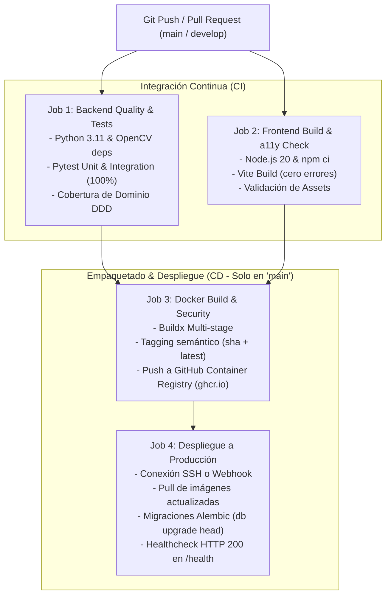

# Especificación y Guía del Pipeline de CI/CD (GitHub Actions)

**Sistema:** Sistema de Apoyo al Diagnóstico Odontológico para Detección de Caries (CDSS)  
**Entorno de Ejecución:** GitHub Actions Runner (`ubuntu-latest`)  
**Estrategia de Despliegue:** Contenedores Docker / Multi-stage Build  
**Registro de Contenedores:** GitHub Container Registry (`ghcr.io`)  
**Versión:** 1.0.0  
**Fecha:** 2026-11-07  

---

## 1. Visión General del Pipeline

El pipeline de Integración y Despliegue Continuo (CI/CD) automatiza la verificación de calidad de código, pruebas unitarias del dominio, empaquetado del frontend y construcción de imágenes Docker para producción, garantizando que **ningún código que rompa las invariantes clínicas o falle pruebas llegue al servidor**.



---

## 2. Definición de Etapas (Jobs)

### Job 1: `backend-ci` (Pruebas y Verificación del Backend)
* **Objetivo:** Ejecutar la suite completa de pruebas unitarias y de integración de FastAPI, SQLAlchemy y adaptadores de ML.
* **Pre-requisitos del Sistema:** Instalación de bibliotecas de renderizado gráfico de Linux requeridas por OpenCV y Ultralytics (`libgl1`, `libglib2.0-0`).
* **Comandos:**
  ```bash
  sudo apt-get update && sudo apt-get install -y libgl1 libglib2.0-0
  pip install --upgrade pip
  pip install -r backend/requirements.txt
  pytest backend/tests/unit -v --durations=10
  ```
* **Criterio de Aprobación:** Cero fallos (`0 failures`, código de salida `0`). Tiempo promedio de ejecución: $\le 90\text{ segundos}$.

### Job 2: `frontend-ci` (Compilación y Verificación de UI)
* **Objetivo:** Validar que todos los componentes React, rutas y estilos Tailwind compilen sin referencias rotas o dependencias ausentes.
* **Comandos:**
  ```bash
  cd frontend
  npm ci
  npm run build
  ```
* **Criterio de Aprobación:** Creación limpia del directorio `frontend/dist/`.

### Job 3: `docker-package` (Empaquetado de Contenedores)
* **Disparador:** Únicamente al fusionar (*merge*) en la rama `main` o al crear etiquetas de versión (`v*`).
* **Imágenes generadas:**
  * `ghcr.io/<owner>/dental-caries-backend:latest` y `:sha-<commit>`
  * `ghcr.io/<owner>/dental-caries-frontend:latest` y `:sha-<commit>`
* **Caché:** `type=gha` (GitHub Actions Cache) para acelerar descargas de capas Docker repetidas.

### Job 4: `deploy-production` (Despliegue Continuo)
* **Mecanismo:** Despliegue seguro mediante SSH en servidor Linux o webhook hacia PaaS (Render / Railway / VPS con Docker Compose).
* **Secuencia de Despliegue:**
  1. Descarga de nuevas imágenes desde el registro privado.
  2. Ejecución de migraciones de base de datos Alembic: `alembic upgrade head`.
  3. Reinicio progresivo de contenedores (`docker compose up -d --remove-orphans`).
  4. Verificación de salud (*Healthcheck*): `curl -f http://localhost:8000/docs` o `/api/v1/modelos/`.

---

## 3. Matriz de Variables y Secretos Requeridos en GitHub

Para habilitar el despliegue automático, configurar en **GitHub Repository $\to$ Settings $\to$ Secrets and variables $\to$ Actions**:

| Nombre del Secreto | Obligatorio | Descripción / Ejemplo |
| :--- | :--- | :--- |
| `DEPLOY_HOST` | Sí (si usa VPS) | Dirección IP o dominio del servidor de producción (ej. `203.0.113.10`). |
| `DEPLOY_USER` | Sí (si usa VPS) | Usuario SSH del servidor con permisos Docker (ej. `ubuntu` o `deployer`). |
| `DEPLOY_SSH_KEY` | Sí (si usa VPS) | Clave privada SSH (formato PEM / OpenSSH) autorizada en `~/.ssh/authorized_keys`. |
| `DEPLOY_PORT` | No | Puerto SSH (por defecto `22`). |
| `DATABASE_URL` | Sí | Cadena de conexión PostgreSQL de producción (`postgresql://user:pass@db:5432/dental_app_db`). |
| `SECRET_KEY` | Sí | Clave de firma criptográfica de la aplicación. |
| `GITHUB_TOKEN` | Automático | Provisto por defecto por GitHub para autenticar en `ghcr.io`. |

---

## 4. Archivo de Configuración del Flujo de Trabajo

El archivo canónico ejecutable reside en:  
[`.github/workflows/ci-cd.yml`](../../.github/workflows/ci-cd.yml)

### Disparadores Configurados (*Triggers*):
```yaml
on:
  push:
    branches: [ main, develop ]
  pull_request:
    branches: [ main, develop ]
  workflow_dispatch: # Permite ejecución manual desde la web de GitHub
```

---

## 5. Procedimiento de Despliegue Rápido en Servidor (Turnkey)

En el servidor de producción o VPS, basta con tener Docker instalado y clonar el `docker-compose.yaml`:

```bash
# 1. Autenticarse al registro de GitHub (si las imágenes son privadas)
echo $CR_PAT | docker login ghcr.io -u <GITHUB_USERNAME> --password-stdin

# 2. Descargar e iniciar los servicios
docker compose -f docker-compose.yaml pull
docker compose -f docker-compose.yaml up -d

# 3. Aplicar migraciones de base de datos
docker compose -f docker-compose.yaml exec backend alembic upgrade head
```

