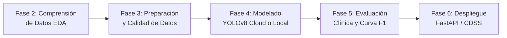
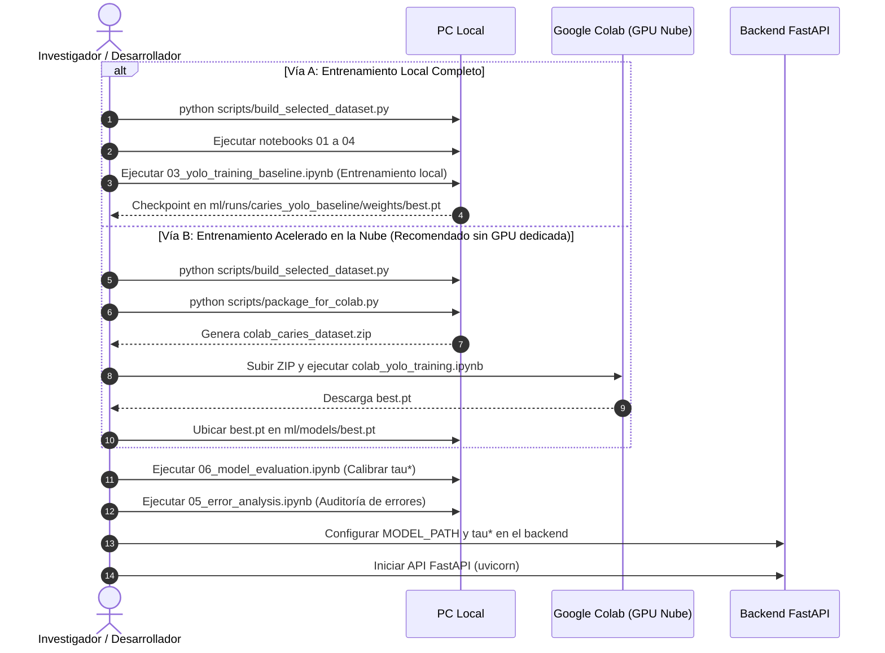

# Pipeline Experimental de Machine Learning — Detección de Caries en Fotografía Intraoral

Guía técnica, operativa y metodológica para la auditoría, reproducción y extensión del pipeline de visión artificial aplicado al soporte del diagnóstico odontológico (*Clinical Decision Support System* - CDSS).

---

## 1. Alcance Clínico y Marco Metodológico

### 1.1 Metodología CRISP-DM
El ciclo de experimentación de este proyecto implementa formalmente la metodología estándar **CRISP-DM** (*Cross-Industry Standard Process for Data Mining*), estructurada para proyectos de software médico (**e-Health**):



### 1.2 Alcance Clínico y Taxonomía Epidemiológica OMS
El sistema opera exclusivamente sobre **fotografías intraorales directas en luz visible** (obtenidas mediante cámaras intraorales o fotografía clínica réflex), descartando la radiología periapical o panorámica.

El modelo resuelve una tarea de detección de objetos multiclase orientada a dos entidades clínicas diferenciadas según los índices epidemiológicos de la **Organización Mundial de la Salud (OMS)**:

* **Clase `0` — `caries_permanente`:** Lesiones cariosas en piezas dentales permanentes. Se asocia al componente cariado ($D$) del **Índice CPO-D / DMFT** (*Decayed, Missing, Filled Teeth*).
* **Clase `1` — `caries_decidua`:** Lesiones cariosas en piezas dentales deciduas ("de leche") en odontopediatría. Se asocia al componente cariado ($d$) del **Índice ceo-d / dmft** (*decayed, extracted, filled primary teeth*).
* **Controles Sanos (Background Negativo):** Fotografías intraorales de cuadrantes o piezas dentales sanas, registradas con archivos de anotación de $0\text{ bytes}$. Su función es regular la tasa de falsos positivos y entrenar al detector en la discriminación de esmalte íntegro.

---

## 2. Mapa de Ruta de los Notebooks (CRISP-DM Mapping)

Los notebooks en este directorio (`notebooks/`) están diseñados de forma modular e independiente para cubrir cada fase del ciclo de vida del modelo:

| Notebook | Fase CRISP-DM | Propósito Principal | Entrada | Salida / Artefacto |
| :--- | :--- | :--- | :--- | :--- |
| [`01_dataset_setup.ipynb`](01_dataset_setup.ipynb) | **Fase 3: Data Preparation** | Verificación de estructura de directorios, partición de datos y validación de [`data.yaml`](../ml/configs/data.yaml). | `dataset/selected/`, `data.yaml` | Reporte de integridad de partición (1,957 imágenes: 1,362 train / 290 val / 305 test). |
| [`02_dataset_exploration_and_sanity_checks.ipynb`](02_dataset_exploration_and_sanity_checks.ipynb) | **Fase 2: Data Understanding** | Análisis exploratorio de datos (EDA), cálculo de prevalencia (91.3% permanente vs. 8.7% decidua) y visualización clínica. | `dataset/selected/` | Histogramas de frecuencia, distribución de bounding boxes y visualizaciones diagnósticas. |
| [`03_yolo_training_baseline.ipynb`](03_yolo_training_baseline.ipynb) | **Fase 4: Modeling** | Entrenamiento determinista del baseline en PC local con soporte automático de GPU (`cuda`) o `cpu`. | `dataset/selected/`, `data.yaml` | Checkpoints locales (`best.pt`, `last.pt`) y metadatos de trazabilidad en `ml/runs/`. |
| [`04_annotation_quality_check.ipynb`](04_annotation_quality_check.ipynb) | **Fase 3: Data Preparation** | Control de calidad matemática: coordenadas acotadas en $[0, 1]$, detección de cajas degeneradas ($área \le 0$) y controles sanos. | `dataset/selected/labels/` | Certificación matemática de calidad de etiquetas ($0\text{ inconsistencias}$). |
| [`05_error_analysis.ipynb`](05_error_analysis.ipynb) | **Fase 5: Evaluation** | Auditoría cualitativa de fallas clínicas: identificación de Falsos Negativos (subdiagnóstico) y Falsos Positivos (sobre-tratamiento). | `best.pt`, `dataset/selected/images/test` | Galería comparativa *Ground Truth* vs. *Predicción* para la discusión de resultados. |
| [`06_model_evaluation.ipynb`](06_model_evaluation.ipynb) | **Fase 5: Evaluation** | Evaluación cuantitativa sobre el split de prueba (305 imágenes). Genera matriz de confusión y calibra el umbral óptimo $\tau^*$. | `best.pt`, `data.yaml` | Métricas finales ($Precision$, $Recall$, $mAP_{50}$, $mAP_{50-95}$) y cálculo de $\tau^* = \arg\max_\tau F1(\tau)$. |
| [`07_inference_pipeline.ipynb`](07_inference_pipeline.ipynb) | **Fase 6: Deployment** | Prueba unitaria del contrato de inferencia (`boxes`, `confs`, `cls`) y medición de latencia por cuadro. | `best.pt`, imagen de prueba | Deserialización de cajas normalizadas y benchmark de tiempo de respuesta. |
| [`08_clinical_use_case_demo.ipynb`](08_clinical_use_case_demo.ipynb) | **Fase 6: Deployment** | Demostración *end-to-end* del flujo clínico: carga de fotografía, detección de lesiones y reporte para historia clínica. | `best.pt`, imágenes clínicas | Reporte visual interactivo simulando la interacción odontológica. |
| [`colab_yolo_training.ipynb`](colab_yolo_training.ipynb) | **Fase 4: Modeling (Cloud)** | Pipeline optimizado para ejecución en Google Colab con GPU T4 y precisión mixta (FP16). | `colab_caries_dataset.zip` | Checkpoint optimizado `best.pt` y métricas de convergencia (`results.csv`). |

---

## 3. Opciones de Flujo de Trabajo

Cualquier usuario o investigador que clone el repositorio puede optar por dos vías de ejecución según la capacidad de cómputo de su PC local:



---

### Vía A: Pipeline Local Completo (PC con GPU CUDA o CPU)

Si la PC local cuenta con recursos suficientes para entrenar modelos de visión artificial:

1. **Construir el dataset balanceado:**
   ```bash
   python scripts/build_selected_dataset.py
   ```
2. **Ejecutar validación y exploración:**
   Abrir y ejecutar [`01_dataset_setup.ipynb`](01_dataset_setup.ipynb), [`02_dataset_exploration_and_sanity_checks.ipynb`](02_dataset_exploration_and_sanity_checks.ipynb) y [`04_annotation_quality_check.ipynb`](04_annotation_quality_check.ipynb).
3. **Entrenar el modelo baseline:**
   Ejecutar [`03_yolo_training_baseline.ipynb`](03_yolo_training_baseline.ipynb). El script detectará automáticamente los aceleradores disponibles (`cuda` o `cpu`) y persistirá los pesos en:
   ```text
   ml/runs/caries_yolo_baseline/weights/best.pt
   ```
4. **Evaluar el rendimiento:**
   Continuar con los notebooks [`06_model_evaluation.ipynb`](06_model_evaluation.ipynb) y [`05_error_analysis.ipynb`](05_error_analysis.ipynb).

---

### Vía B: Flujo Acelerado en la Nube (Google Colab) + Auditoría Local

Recomendado cuando la PC local no dispone de una GPU dedicada de alto rendimiento:

1. **Preparación y empaquetado del dataset:**
   Desde la raíz del proyecto en la PC local:
   ```bash
   # Construir la partición 70/15/15 por paciente con clipping preventivo
   python scripts/build_selected_dataset.py

   # Empaquetar el dataset procesado y data.yaml en un archivo zip optimizado
   python scripts/package_for_colab.py
   ```
   Esto genera el archivo `colab_caries_dataset.zip` (~393 MB).

2. **Entrenamiento en Google Colab:**
   * Cargar `colab_caries_dataset.zip` en Google Drive dentro del directorio:
     ```text
     MyDrive/dental-caries/colab_caries_dataset.zip
     ```
   * Abrir y ejecutar [`colab_yolo_training.ipynb`](colab_yolo_training.ipynb) en Colab seleccionando entorno de ejecución con GPU (ej. T4).
   * Al finalizar el entrenamiento, descargar el archivo de pesos resultante `best.pt`.

3. **Ubicación del modelo en la PC local:**
   Copiar el archivo descargado al directorio de modelos del proyecto:
   ```text
   ml/models/best.pt
   ```

4. **Auditoría clínica local:**
   * **Ejecutar [`06_model_evaluation.ipynb`](06_model_evaluation.ipynb):** Evalúa el modelo sobre las 305 imágenes de prueba independientes (`dataset/selected/images/test`) y determina el umbral clínico óptimo $\tau^* = \arg\max_\tau F1(\tau)$ para maximizar el balance entre sensibilidad y precisión.
   * **Ejecutar [`05_error_analysis.ipynb`](05_error_analysis.ipynb):** Inspecciona visualmente los casos de Falsos Negativos y Falsos Positivos para auditar el comportamiento del modelo frente a factores clínicos (saliva, sombras, tinciones de surcos).
   * **Ejecutar [`07_inference_pipeline.ipynb`](07_inference_pipeline.ipynb) y [`08_clinical_use_case_demo.ipynb`](08_clinical_use_case_demo.ipynb):** Pruebas de integración del pipeline y simulación del caso de uso.

---

## 4. Despliegue e Integración en el Backend FastAPI

Una vez disponible el artefacto `best.pt` en `ml/models/best.pt`:

1. **Verificar el mapeo de clases multiclase en el adaptador:**
   En [`backend/app/infrastructure/ml/yolo_detector.py`](../backend/app/infrastructure/ml/yolo_detector.py), verificar que ambas clases de salida del modelo estén asociadas al dominio:
   ```python
   _CLASS_MAP: dict[int, str] = {
       0: "CARIES",  # caries_permanente
       1: "CARIES",  # caries_decidua
   }
   ```

2. **Configurar variables de entorno:**
   En [`backend/.env`](../backend/.env):
   ```env
   MODEL_PATH=../ml/models/best.pt
   ```

3. **Establecer el umbral clínico operativo:**
   En [`backend/app/core/config/settings.py`](../backend/app/core/config/settings.py), ajustar `MODEL_CONFIDENCE_THRESHOLD` con el valor $\tau^*$ calibrado en el notebook `06`.

4. **Ejecutar la API REST:**
   ```bash
   cd backend
   uvicorn app.main:app --reload
   ```
   El endpoint `POST /api/v1/diagnosticos/analizar` procesará fotografías intraorales en tiempo real devolviendo las coordenadas normalizadas y el nivel de severidad de cada hallazgo.

---

## 5. Convenciones de Reproducibilidad e Integridad de Datos

* **Aislamiento por Paciente (Zero Data Leakage):** La división del dataset (70% train, 15% val, 15% test) se realiza estrictamente a nivel de paciente (`Patient_ID`). Todas las imágenes correspondientes a un mismo individuo pertenecen exclusivamente a una única partición.
* **Idempotencia:** El script [`scripts/build_selected_dataset.py`](../scripts/build_selected_dataset.py) limpia y reconstruye las carpetas de destino de forma determinista, permitiendo reejecuciones sin riesgo de duplicación.
* **Clipping Preventivo de Coordenadas:** Toda anotación es truncada preventivamente al intervalo cerrado $[0.0, 1.0]$:
  $$x_{\text{norm}} = \min(\max(x, 0.0), 1.0)$$
* **Semillas Deterministas:** El entrenamiento fija `seed=42` y `deterministic=True` para garantizar resultados reproducibles entre ejecuciones.
* **Trazabilidad:** Cada ejecución registra un archivo `experiment_metadata.json` con fecha, entorno de ejecución, versiones de dependencias e hiperparámetros.

---

## 6. Referencias
1. **Ahmed et al. (2023):** *A comprehensive dataset of intraoral images for dental caries detection*.
2. **Organización Mundial de la Salud (OMS / WHO, 2013):** *Oral health surveys: basic methods - 5th edition*.
3. **Ultralytics YOLOv8:** *Real-Time Object Detection and Segmentation*.
4. **CRISP-DM Consortium:** *Cross-Industry Standard Process for Data Mining*.
